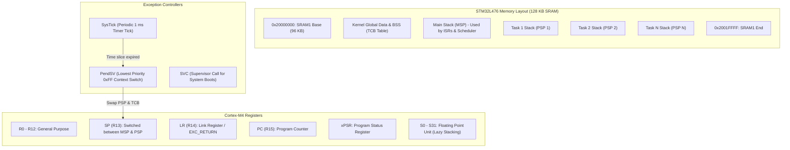
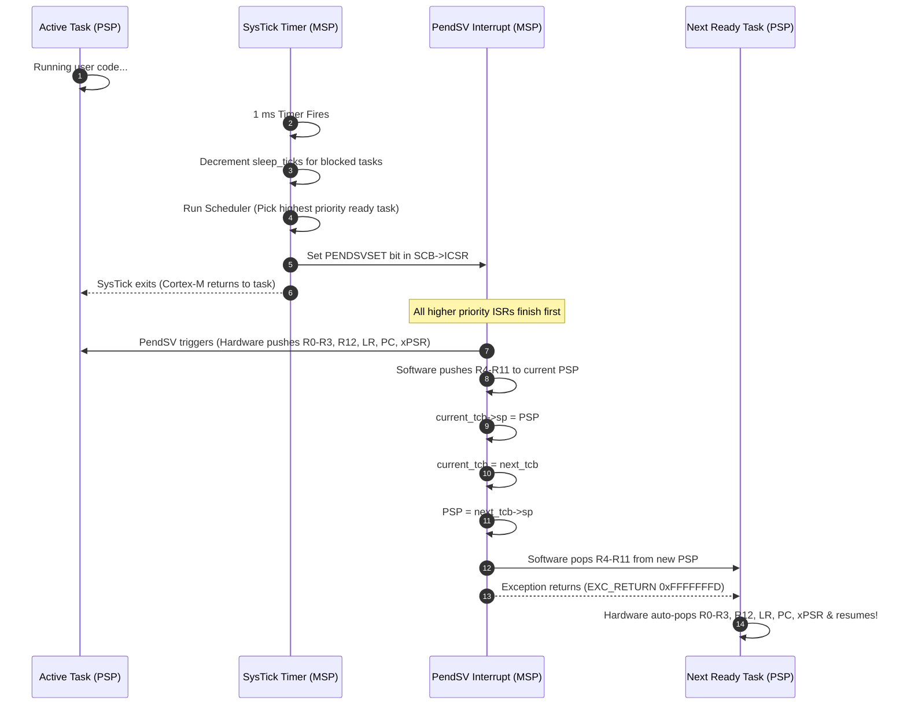

# ZenRTOS: Architecture & Technical Design Document
## Preemptive Real-Time Operating System in Zen-C for STM32L476 (ARM Cortex-M4)

**Document Version:** 1.0  
**Target Hardware:** STM32L476xx (ARM Cortex-M4F @ 80 MHz, 128 KB SRAM, 1 MB Flash)  
**Primary Language:** Zen-C (`.zc`) with minimal Thumb-2 Assembly  
**Toolchain:** Zen-C Compiler (`zc`) + LLVM/Clang (`--target=arm-none-eabi`) or GCC (`arm-none-eabi-gcc`)  

---

## 1. System Overview & Core Objectives

**ZenRTOS** is an ultra-lightweight, deterministic, preemptive real-time operating system kernel designed specifically for ARM Cortex-M microcontrollers and authored in **Zen-C**.

### Key Architectural Tenets
1. **Zero Runtime Overhead**: No heap allocation required by the kernel core. All Task Control Blocks (TCBs) and stacks are statically determinable.
2. **Dual-Stack Hardware Isolation**: The kernel, exception handlers, and ISRs execute on the **Main Stack Pointer (MSP)**. User tasks execute exclusively on their individual **Process Stack Pointers (PSP)**.
3. **Lowest-Priority Deferred Context Switching**: Context switching is executed exclusively in the `PendSV` interrupt handler configured at the lowest possible priority (`0xFF`), guaranteeing that zero interrupt jitter is imposed on real-time hardware ISRs.
4. **Ergonomic Zen-C Abstraction**: Leverages Zen-C's modern typing, explicit bounds, and module structure while transpiling directly into strictly MISRA-compliant freestanding C.

---

## 2. Cortex-M4 Hardware Execution & Memory Model



### 2.1 Hardware Stack Frame vs. Software Stack Frame
When a context switch occurs, the processor saves half the registers automatically in hardware, and `PendSV` saves the remaining half in software:

```
+-----------------------------------------------------------+
| High Address                                              |
+-----------------------------------------------------------+
| xPSR          (Hardware saved - Thumb bit must be 1)      |
| PC            (Hardware saved - Task entry point)         |
| LR            (Hardware saved - Task exit stub / hook)    |
| R12           (Hardware saved)                            |
| R3            (Hardware saved)                            |
| R2            (Hardware saved)                            |
| R1            (Hardware saved)                            |
| R0            (Hardware saved - Task argument void *arg)  |
+-----------------------------------------------------------+ <--- Hardware Exception Entry
| R11           (Software saved by PendSV)                  |
| R10           (Software saved by PendSV)                  |
| R9            (Software saved by PendSV)                  |
| R8            (Software saved by PendSV)                  |
| R7            (Software saved by PendSV)                  |
| R6            (Software saved by PendSV)                  |
| R5            (Software saved by PendSV)                  |
| R4            (Software saved by PendSV)                  |
+-----------------------------------------------------------+ <--- Saved PSP in TCB
| Low Address (Stack Growth Downwards)                      |
+-----------------------------------------------------------+
```

---

## 3. Kernel Components & Data Structures

### 3.1 Task Control Block (TCB)
The `sp` pointer **must strictly reside at offset 0** of the structure to ensure single-cycle access from assembly (`ldr r0, [r1]`):

```zc
// zen-rtos/kernel/types.zc
enum TaskState {
    Ready,
    Blocked,
    Suspended
}

struct TCB {
    sp: *u32,             // Process Stack Pointer (Offset 0)
    id: u32,              // Unique task identifier
    priority: u32,        // 0 (Highest) to N (Lowest)
    state: TaskState,     // Current lifecycle state
    sleep_ticks: u32,     // Remaining SysTick count for delay
    stack_base: *u32,     // Lowest address of allocated stack buffer
    stack_size: u32,      // Total words allocated for stack canary check
    name: *const char     // Debugging label
}
```

### 3.2 System Call & Execution Flow


---

## 4. Scheduler Design & Scheduling Invariants

1. **Preemptive Priority Scheduler with Round-Robin Aging**:
   - Tasks are indexed by priorities $0$ (highest) to $31$ (lowest).
   - If multiple tasks share the highest active priority, execution alternates in Round-Robin fashion upon each SysTick.
2. **Deterministic Time Complexity**:
   - Ready task lookup is $O(1)$ via a 32-bit priority bitmap (`__builtin_clz` count-leading-zeros single-cycle instruction).
3. **Idle Task Invariant**:
   - A dedicated lowest-priority Idle Task (`priority = 31`) is always running when all user tasks are asleep. It executes the `wfi` (Wait For Interrupt) low-power instruction to conserve battery.

---

## 5. Zen-C Language Integration Architecture

Zen-C compiles to freestanding C (`zc transpile --free`), enabling clean modular development while maintaining full control over microcontroller registers:

```
+-------------------------------------------------------------+
|                      User Application                       |
|           (Written in Zen-C: app.zc, sensors.zc)            |
+-------------------------------------------------------------+
                              |
+-------------------------------------------------------------+
|                      ZenRTOS Kernel                         |
|   • Task Lifecycle (task.zc)     • Queue / Sync (sync.zc)   |
|   • Priority Scheduler (sched.zc)• Timer Wheel (timer.zc)   |
+-------------------------------------------------------------+
                              |
+-------------------------------------------------------------+
|                   Hardware Abstraction                      |
|   • port_asm.s (PendSV context switch in ARM Assembly)       |
|   • port_c.zc (SysTick, NVIC, SCB register configuration)   |
|   • stm32l476.zc (RCC, GPIO, USART register maps)           |
+-------------------------------------------------------------+
```
