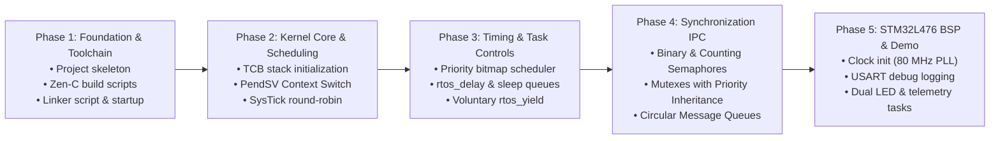

# ZenRTOS: Implementation Plan
## Staged Roadmap for STM32L476 RTOS in Zen-C

**Document Version:** 1.0  

---

## Phase Overview & Milestones



---

## Phase 1: Foundation, Toolchain & Startup (Milestone 1)
- [ ] Initialize repository structure at `/home/mark/projects/zen-rtos`:
  ```
  zen-rtos/
  ├── kernel/             # Zen-C RTOS Kernel source (.zc)
  │   ├── types.zc        # TCB, task states, error codes
  │   ├── kernel.zc       # Core lifecycle API (init, start)
  │   ├── sched.zc        # Scheduling algorithms
  │   └── sync.zc         # Semaphores, mutexes, queues
  ├── arch/arm/cortex-m4/ # Port layer
  │   ├── context.s       # PendSV_Handler Thumb-2 assembly
  │   ├── port.zc         # SysTick and SCB configurations
  │   └── startup.s       # Reset_Handler & Vector Table
  ├── bsp/stm32l476/      # Board Support Package
  │   ├── link.ld         # Memory linker script (Flash 1MB, SRAM 128KB)
  │   ├── rcc.zc          # Clock configuration
  │   ├── gpio.zc         # Pin control (LED on PA5, Button on PC13)
  │   └── usart.zc        # Serial debug print (USART2 on PA2/PA3)
  ├── app/                # User applications & benchmarks
  │   └── main.zc
  ├── tests/              # Host & Target test suites
  └── Makefile            # Unified compilation & flashing targets
  ```
- [ ] Configure `Makefile` to use `/home/mark/code/Zen-C/zc` for `.zc` transpilation and `clang` or `arm-none-eabi-gcc` for linking bare-metal ELF binaries.
- [ ] Implement Cortex-M4 vector table and linker script for STM32L476RG.

---

## Phase 2: Kernel Core & Context Switching (Milestone 2)
- [ ] **Stack Initialization (`rtos_task_create`)**:
  - Implement fake exception stack frame synthesis: `xPSR`, `PC`, `LR`, `R12`, `R3`, `R2`, `R1`, `R0`, followed by initial `R4`-`R11`.
- [ ] **PendSV Context Switch Handler (`context.s`)**:
  - Save `R4-R11` of outgoing task to current `PSP`.
  - Store updated `PSP` in `current_tcb->sp`.
  - Load `next_tcb->sp` into `PSP`.
  - Restore `R4-R11` of incoming task.
  - Return with `0xFFFFFFFD` to resume in Thread mode using `PSP`.
- [ ] **SysTick Periodic Scheduler**:
  - Configure SysTick to fire every 1 ms.
  - Round-robin task switcher between 2 cooperative blink tasks.

---

## Phase 3: Time Management, Priority & Task Control (Milestone 3)
- [ ] Implement **`rtos_delay(ms)`**:
  - Move calling task from `TASK_READY` to `TASK_BLOCKED`.
  - Decrement sleep counters in `SysTick_Handler`.
  - Automatically wake task back to `TASK_READY` when tick counter reaches zero.
- [ ] Implement **Priority Bitmap Scheduler**:
  - 32 priority levels ($0$ = highest, $31$ = idle task).
  - Single-cycle priority resolution using `__builtin_clz`.
- [ ] Implement **`rtos_yield()`**:
  - Allow cooperative thread yielding by triggering `SCB->ICSR |= PENDSVSET`.

---

## Phase 4: Inter-Process Communication & Synchronization (Milestone 4)
- [ ] **Binary & Counting Semaphores**:
  - `sem_init`, `sem_wait`, `sem_signal`.
  - Blocking task list when count is zero.
- [ ] **Mutex with Priority Inheritance**:
  - Prevent priority inversion when a low-priority task holds a resource desired by a high-priority task.
- [ ] **Ring-Buffer Message Queue**:
  - Fixed-size message copying for safe task-to-task IPC without dynamic memory allocation.

---

## Phase 5: STM32L476 Board Integration & Final Verification (Milestone 5)
- [ ] Configure STM32L476 System Clock to 80 MHz via Phase-Locked Loop (PLL).
- [ ] Configure USART2 (115200 baud) for formatted kernel trace logs.
- [ ] Run multi-task concurrent application on real or simulated STM32L476:
  - Task 1: High-priority periodic sensor sampler.
  - Task 2: Medium-priority telemetry compressor / queue consumer.
  - Task 3: Low-priority LED heart-beat.
  - Task 4: Background Idle task (`wfi`).
