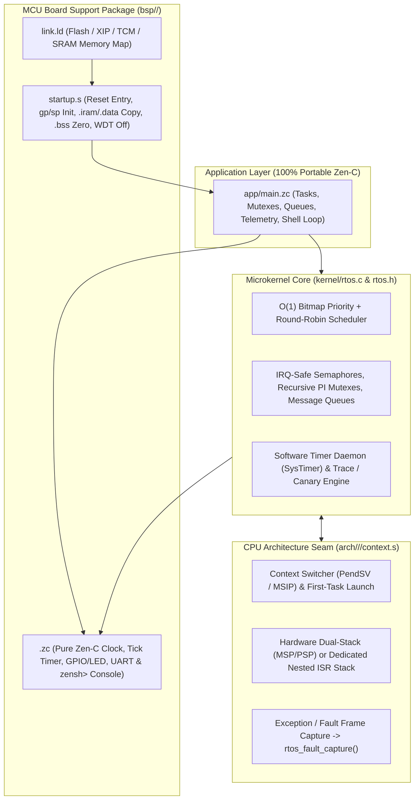

# Guide to Integrating ZenRTOS on Any Microcontroller (MCU)

This guide defines the complete engineering blueprint for integrating **ZenRTOS** onto **any 32-bit microcontroller** — from standard ARM Cortex-M and RISC-V chips to high-speed crossover MCUs (XIP QSPI + TCM) and wireless SoCs with vendor binary stacks.

ZenRTOS is already verified in production across three distinct hardware architectures in this repository:
- **STM32L476RG** — ARM Cortex-M4F @ 4–80 MHz, internal Flash + SRAM (`bsp/stm32l476/`)
- **NXP i.MX RT1021** — ARM Cortex-M7 @ 500 MHz, external FlexSPI NOR XIP + ITCM/DTCM/OCRAM (`bsp/rt1021/`)
- **Waveshare ESP32-C6-Pico** — RISC-V `RV32IMAC` @ 160 MHz, Direct-Boot Cache MMU XIP + 2.4 GHz Wi-Fi 6 (`bsp/esp32c6/`)

---

## 1. Layered Portability Architecture

ZenRTOS isolates hardware dependencies behind two narrow seams — the **ISA Port (`arch/`)** and the **Board Support Package (`bsp/`)** — keeping the core scheduler, synchronization primitives, IPC queues, software timers, stack watermark analyzer, and trace engine **100% MCU-agnostic**:



### Integration Effort Matrix

| Target MCU Family | Examples | `kernel/` | `arch/` | `bsp/<mcu>/` | Typical Effort |
| :--- | :--- | :--- | :--- | :--- | :--- |
| **ARMv7-M / ARMv8-M Mainline** | Cortex-M3, M4, M7, M33, M55 (`STM32F4/H7/U5`, `i.MX RT`, `nRF52/53`, `RP2350`, `GD32`, `SAME70`) | Untouched | Reuse `arch/arm/cortex-m4` or `cortex-m7` | New `link.ld`, `startup.s`, `<mcu>.zc` | **30–60 min** |
| **ARMv6-M / ARMv8-M Baseline** | Cortex-M0, M0+, M23 (`RP2040`, `STM32F0/G0/C0`, `SAMD21`) | Untouched | Split `R4–R7` / `R8–R11` in `context.s` | New `link.ld`, `startup.s`, `<mcu>.zc` | **1–2 hours** |
| **RISC-V 32-bit (`RV32I` / `RV32IMAC`)** | `ESP32-C3/C6/H2`, `CH32V203/307`, `GD32VF103`, `RP2350 Hazard3`, `FE310` | Untouched (`-DRTOS_ARCH_RISCV`) | Reuse `arch/riscv/rv32/context.s` (adapt IRQ controller if non-CLINT) | New `link.ld`, `startup.s`, `<mcu>.zc` | **1–3 hours** |
| **New 32-bit ISA** | Xtensa (`ESP32/S3`), Cortex-R, MIPS32 (`PIC32MZ`) | Add `#elif defined(RTOS_ARCH_<ISA>)` (~40 LOC) | New `arch/<isa>/context.s` | New `link.ld`, `startup.s`, `<mcu>.zc` | **Half day** |

---

## 2. The Hardware-to-Kernel Contract

Before writing any code for a new MCU, verify these **two exact contracts** (Kernel <-> ISA Port, and App <-> BSP).

### 2.1 Kernel <-> ISA Port Contract (`kernel/rtos.c` <-> `arch/`)

1. **`tcb_t` Offset-0 Invariant (`kernel/include/rtos.h`)**:
   - `uint32_t *sp` **must remain the very first field (byte offset `0`)** of `typedef struct tcb`. Every assembly context switcher loads/stores the task stack pointer via `0(tcb_ptr)`.
2. **Global Scheduler Pointers**:
   - `volatile tcb_t *current_tcb`: currently executing task.
   - `volatile tcb_t *next_tcb`: target task chosen by `rtos_schedule()`.
3. **State-Saving Critical Sections**:
   - `uint32_t rtos_irq_save(void)` — atomically reads current interrupt-enable state, disables maskable interrupts, and returns the saved flags.
   - `void rtos_irq_restore(uint32_t flags)` — restores the exact interrupt state from `flags` (never unconditionally re-enables interrupts, making all kernel APIs safe inside nested critical sections and ISRs).
4. **Initial Task Stack Frame (`rtos_task_create_ex`)**:
   - Pre-fills the entire stack buffer with `0xDEADBEEF` (`RTOS_STACK_CANARY`), aligns the top of stack (`8-byte` AAPCS on ARM; `16-byte` psABI on RISC-V), and constructs a synthetic trap frame matching `RESTORE_CONTEXT` with:
     - Entry PC = `func`
     - Argument register (`R0` / `a0`) = `arg`
     - Return address (`LR` / `ra`) = `rtos_task_exit_hook`
     - Status word (`xPSR = 0x01000000` Thumb bit on ARM; `mstatus = 0x1880` `MPP=M, MPIE=1` on RISC-V)
5. **Deferred Context Switch Trigger (`rtos_trigger_pendsv`)**:
   - Pends a lowest-priority software interrupt (`SCB->ICSR = PENDSVSET` on ARM; `CLINT_MSIP = 1` on RISC-V) so context switches never preempt active hardware ISRs.
6. **1000 Hz System Tick (`SysTick_Handler`)**:
   - Periodic `1 ms` timer ISR calls `SysTick_Handler()`, which increments `g_system_ticks`, samples CPU utilization, checks stack canary integrity (`stack_base[0] == 0xDEADBEEF` and `sp >= stack_base`), wakes tasks whose `sleep_ticks` reached `0`, signals the `SysTimer` daemon if software timers expired, and runs `rtos_schedule()`.
7. **First Task Launch (`rtos_start_first_task(uint32_t *sp)`)**:
   - Assembly routine that switches to the first task's stack pointer, enables interrupts, and jumps into the highest-priority task.

### 2.2 Application <-> Zen-C BSP Contract (`app/main.zc` <-> `bsp/<mcu>/<mcu>.zc`)

To boot the standard ZenRTOS multi-tasking demo and interactive `zensh>` shell without modifying `app/main.zc`, your `<mcu>.zc` module exports these functions:

| Function Signature in `<mcu>.zc` | Purpose |
| :--- | :--- |
| `fn bsp_get_cpu_freq_hz() -> u32` | Returns core clock frequency in Hz (used for baud rate & `1000 Hz` tick divider). |
| `fn bsp_init_uart(cpu_freq_hz: u32, baud: u32)` | Enables UART peripheral + TX/RX GPIO pins and configures `115200 8N1` (and RX FIFO/ring buffer if interrupt-driven). |
| `fn bsp_uart_puts(s: char*)` | Transmits a null-terminated string over the console UART/USB-CDC. |
| `fn bsp_init_led()` / `fn bsp_toggle_led()` | Configures the onboard user LED GPIO and toggles its state. |
| `fn bsp_debug_dump_status(shared_temp: u32)` | Prints periodic RTOS telemetry (`Tick`, `CPU Load %`, `CtxSw`, task table & stack free watermarks). |
| `fn bsp_shell_banner()` / `fn bsp_shell_poll(...)` | Non-blocking `zensh>` command-line parser (`help`, `ps`, `mem`, `trace`, `led`, `log`, `reboot`, plus board-specific commands). |

---

## 3. Step-by-Step Integration by MCU Architecture

### Track A: ARM Cortex-M3 / M4 / M7 / M33 / M55

Because ARM standardizes `SysTick` (`0xE000E010`), `PendSV` (`0xE000ED04`), `SHPR3` (`0xE000ED20`), `CONTROL`/`MSP`/`PSP`, and `SCB` fault status registers (`0xE000ED28..0xE000ED38`) across all ARMv7-M and ARMv8-M Mainline cores, **`kernel/rtos.c` and `arch/arm/cortex-m4/context.s` work out of the box**.

#### 1. Create `bsp/<mcu>/link.ld`
Define your MCU's code (`FLASH`) and data (`RAM`) regions and export `_estack`, `_sidata`, `_sdata`, `_edata`, `_sbss`, and `_ebss`:

```ld
ENTRY(Reset_Handler)

MEMORY
{
    FLASH (rx)  : ORIGIN = 0x08000000, LENGTH = 512K   /* Adjust per datasheet */
    RAM   (rwx) : ORIGIN = 0x20000000, LENGTH = 128K   /* Adjust per datasheet */
}

_estack = ORIGIN(RAM) + LENGTH(RAM);

SECTIONS
{
    .isr_vector : { KEEP(*(.isr_vector)) } > FLASH
    .text       : { . = ALIGN(4); *(.text*) *(.rodata*) . = ALIGN(4); _etext = .; } > FLASH

    _sidata = LOADADDR(.data);
    .data       : { . = ALIGN(4); _sdata = .; *(.data*) . = ALIGN(4); _edata = .; } > RAM AT > FLASH

    .bss        : { . = ALIGN(4); _sbss = .; *(.bss*) *(COMMON) . = ALIGN(4); _ebss = .; } > RAM
}
```

> **Crossover MCUs (e.g., NXP i.MX RT10xx / STM32H7 External QSPI XIP):**
> - Prepend any ROM-required boot configuration structures (such as FlexSPI `FCFB` + `IVT` + `BootData` in `bsp/rt1021/boot_hdr.c`) before `.isr_vector`.
> - Place `.data` and `.bss` in deterministic non-cached `DTCM` or `OCRAM`, and set `SCB->VTOR` (`0xE000ED08`) in `Reset_Handler` to point to `g_pfnVectors`.
> - If enabling Cortex-M7 D-Cache alongside DMA peripherals, either place DMA descriptors/buffers in a non-cacheable MPU region (`DTCM`) or clean/invalidate cache lines (`SCB_CleanDCache_by_Addr` / `SCB_InvalidateDCache_by_Addr`).

#### 2. Create `bsp/<mcu>/startup.s`
Populate the standard 16 Cortex-M core vectors (`_estack`, `Reset_Handler`, `NMI`, `HardFault_Handler`, `MemManage_Handler`, `BusFault_Handler`, `UsageFault_Handler`, ..., `PendSV_Handler` at slot 14, `SysTick_Handler` at slot 15), followed by your chip's peripheral IRQs:
- Disable any boot-enabled hardware watchdogs early in `Reset_Handler` (before slow `.bss` loops if RAM is large).
- Copy `.data` (`_sidata` -> `_sdata.._edata`), zero `.bss` (`_sbss.._ebss`), optionally enable FPU (`CPACR |= (0xF << 20)` if compiling with `-mfloat-abi=hard` and adding lazy FPU `S16–S31` stacking in `PendSV`), and `bl main`.

#### 3. Create `bsp/<mcu>/<mcu>.zc`
Copy `bsp/stm32l476/stm32l476.zc` or `bsp/rt1021/rt1021.zc` as a template. Only the MMIO addresses at the top of the file and the 4 hardware functions (`bsp_get_cpu_freq_hz`, `bsp_init_led`, `bsp_set_led`, `bsp_init_uart` / `bsp_uart_putc` / `bsp_uart_getc`) need register changes; the entire `zensh>` shell and telemetry formatter reuse your `bsp_uart_putc` / `bsp_uart_getc`.

---

### Track B: ARM Cortex-M0 / M0+ / M23 (ARMv6-M / Baseline)

ARMv6-M omits Thumb-2 `stmdb r0!, {r4-r11}` and `ldmia r0!, {r4-r11}` on high registers (`R8–R11`):
1. Create `arch/arm/cortex-m0/context.s` where `PendSV_Handler` reserves 32 bytes (`subs r0, #32`), saves `R4–R7` with `stmia r0!, {r4-r7}`, copies `R8–R11` into `R4–R7` via `mov`, and saves the second 4-word block with `stmia r0!, {r4-r7}` (reversing the order on restore).
2. Note that `SCB_SHPR3` (`0xE000ED20`) on Cortex-M0/M0+ **only supports 32-bit word accesses** (`SCB_SHPR3 |= (0xFFUL << 16)` in `kernel/rtos.c` already uses a 32-bit `uint32_t` access, so it is compatible as-is).
3. Omit `MemManage_Handler`, `BusFault_Handler`, and `UsageFault_Handler` (Cortex-M0 escalates all faults to `HardFault_Handler`), and replace `tst lr, #4; ite eq` with `mov r0, lr; movs r1, #4; tst r0, r1; beq ...`.

---

### Track C: 32-bit RISC-V (`RV32I` / `RV32IMAC`)

Compile with `-DRTOS_ARCH_RISCV` and reuse `arch/riscv/rv32/context.s`. Key architectural items to verify per RISC-V vendor:

1. **Global Pointer (`gp`) Initialization**:
   - Define `PROVIDE(__global_pointer$ = _sdata + 0x800);` in `link.ld` and initialize `gp` at the very start of `_start` inside `.option push; .option norelax; la gp, __global_pointer$; .option pop` **before** calling any C code.
2. **Vectored `mtvec` Alignment**:
   - RISC-V vectored mode (`mtvec[1:0] = 0b01`) requires `_mtvec_table` to be aligned to at least `64` or `256` bytes (`.balign 256` in `context.s`). Ensure `link.ld` keeps `.mtvec_table` in executable RAM (`IRAM`) or XIP Flash with `ALIGN(256)`.
3. **Dedicated 4 KB Nested Interrupt Stack (`g_isr_stack`)**:
   - Unlike Cortex-M (which switches `PSP -> MSP` automatically in hardware), RISC-V traps enter on the interrupted task's `sp`. `arch/riscv/rv32/context.s` provides `ENTER_ISR_STACK` and `EXIT_ISR_STACK` backed by a 4 KB `g_isr_stack` and `g_isr_nest_depth`, protecting small 512 B–1 KB task stacks from deep peripheral/radio ISRs.
4. **Timer & Software Interrupt Controller Mapping**:
   - **Standard RISC-V CLINT** (`FE310`, `ESP32-C6` core timer): `MTIMER` is vectored slot `7` (`bsp_start_mtimer` + `bsp_ack_mtimer` writing `MTIMECMP` in `<mcu>.zc`), and `MSIP` is vectored slot `3` (`CLINT_MSIP_REG` address in `kernel/rtos.c`).
   - **Vendor CLIC / ECLIC / PFIC** (`WCH CH32V`, `GigaDevice GD32VF103`, `ESP32-C3` SYSTIMER+INTMTX): map `rtos_trigger_pendsv()` to the chip's software interrupt pending register (e.g., `PFIC->ISR` SWI bit 14 on CH32V, or `CPU_INTR_FROM_CPU_0` on ESP32-C3) configured at the lowest interrupt priority, and point the periodic 1 kHz timer vector to `riscv_mtimer_handler`.

---

### Track D: Adding a Brand-New ISA (e.g., Xtensa, MIPS, Cortex-R)

To add a completely new processor architecture `<isa>`, only ~40 lines in `kernel/rtos.c` and one assembly file `arch/<isa>/context.s` are required:

1. **`kernel/rtos.c` (`#elif defined(RTOS_ARCH_<ISA>)`)**:
   - Implement `rtos_irq_save()` and `rtos_irq_restore(uint32_t flags)`.
   - Implement `rtos_trigger_pendsv()` (software interrupt or synchronous yield trap).
   - Add the initial stack-frame layout in `rtos_task_create_ex()` matching your `RESTORE_CONTEXT` macro (`func`, `arg`, `rtos_task_exit_hook`, initial status register, and stack alignment).
   - Add the tick timer startup call in `rtos_start(cpu_freq_hz, tick_freq_hz)`.
   - Map `SCB_CFSR` / `SCB_HFSR` / `SCB_MMFAR` / `SCB_BFAR` macros to your CPU's exception cause/address CSRs (e.g., `EXCCAUSE` / `EXCVADDR` on Xtensa) for post-mortem `g_fault_info` capture.
2. **`arch/<isa>/context.s`**:
   - Implement `rtos_start_first_task`, the software context-switch ISR, the 1 kHz timer ISR wrapper calling `SysTick_Handler`, and the fault/exception entry calling `rtos_fault_capture`.

---

## 4. Critical Silicon Bring-Up Lessons & Advanced Peripherals

When porting to modern complex SoCs (wireless combos, dual-core/TEE security chips, or high-speed DMA peripherals), watch for these five hardware traps proven during ZenRTOS bring-up:

1. **Hardware Watchdogs Armed out of Reset**:
   - Many MCUs (`ESP32-C6` TIMG0/LP/Super WDT, `i.MX RT1021` WDOG1/WDOG2/RTWDOG, `SAM` WDT, `MSP432` WDT_A) boot with watchdogs **enabled** by mask ROM. Unlock and disable them in `startup.s` / early BSP init before `.bss` zeroing or calibration routines.
2. **Default Bus Access / DMA Security Filters (TEE / APM / XRDC /TZ)**:
   - Chips with TrustZone or TEE peripherals (such as `ESP32-C6`'s `HP_APM`, `LP_APM0`, `LP_APM`, or NXP's `XRDC`/`CSU`) often allow CPU reads/writes out of reset while **silently blocking non-CPU DMA masters** (Ethernet, USB, SDIO, Wi-Fi MAC) from accessing SRAM. Explicitly configure or open bus master permissions during BSP bring-up before starting DMA engines.
3. **Power Management Unit (PMU) & Clock-Gating Latches**:
   - Modern low-power SoCs gate peripheral and radio clock domains via multi-state PMU tables that require pulsing immediate-update latch bits (`PMU_IMM_*`) after writing configuration registers. Never assume writing a clock-enable bit alone ungates a domain without checking its power-state bitmap.
4. **Integrating Vendor Binary Stacks (Wi-Fi / BLE / USB / Ethernet)**:
   - ZenRTOS includes all primitives needed to host complex vendor stacks without FreeRTOS (`bsp/esp32c6/wifi_osi.c` + `wifi_heap.c` + `wifi_libc.c` serve as a reference implementation):
     - **Dynamic Memory**: Drop in `wifi_heap.c` (16-byte-aligned, IRQ-safe free-list arena of configurable size) while keeping the core RTOS statically allocated.
     - **ISR-to-Task Wakeup**: Use `rtos_sem_signal_from_isr(&sem, &woken)` inside peripheral ISRs; pair with a dedicated 4 KB ISR stack so heavy vendor ISRs cannot overflow small application task stacks.
     - **Non-Blocking vs. Infinite Waits**: Map poll calls (`timeout = 0`) directly to `rtos_sem_wait(s, 0)` / `rtos_mutex_lock(m, 0)` and infinite waits to `RTOS_WAIT_FOREVER` (`0xFFFFFFFFUL`).
     - **Custom Linker Sections**: Inspect vendor `.a` archives with `llvm-objdump -h` and map every custom `.iram*` / `.ramfunc*` section inside `.iram1 > RAM AT > FLASH` in `link.ld` so `llvm-objcopy -O binary` never emits multi-megabyte LMA gaps.

---

## 5. Build System (`Makefile`) Integration Template

ZenRTOS uses the **Zen-C transpiler (`zc transpile --freestanding`)** paired with **LLVM/Clang + `lld`** (a single cross-compiler binary supports ARM, RISC-V, Xtensa/MIPS, and host targets without installing separate GCC toolchains per vendor).

Add three concise rules to `Makefile` for your new `<mcu>`:

```makefile
CFLAGS_<MCU>  ?= --target=arm-none-eabi -mcpu=cortex-m33 -mthumb \
                 -mfloat-abi=soft -O2 -Wall -Wextra -ffreestanding \
                 -DZC_FUNC= -DZC_GLOBAL= \
                 -Ikernel/include -Ibsp/<mcu> -Iarch/arm/cortex-m4 \
                 -fdata-sections -ffunction-sections

LDFLAGS_<MCU> ?= --target=arm-none-eabi -mcpu=cortex-m33 -mthumb \
                 -nostdlib -fuse-ld=lld \
                 -Wl,-T,bsp/<mcu>/link.ld -Wl,--gc-sections

$(BUILD_DIR)/<mcu>_zc.c: bsp/<mcu>/<mcu>.zc kernel/include/rtos.h
	@mkdir -p $(BUILD_DIR)
	$(ZC) transpile --freestanding $< -Ikernel/include -o $@

<mcu>: $(BUILD_DIR)/zen_rtos_<mcu>.bin

$(BUILD_DIR)/zen_rtos_<mcu>.elf: kernel/rtos.c \
                                 arch/arm/cortex-m4/context.s \
                                 bsp/<mcu>/startup.s \
                                 $(BUILD_DIR)/<mcu>_zc.c \
                                 app/main_zc.c \
                                 bsp/<mcu>/link.ld
	@mkdir -p $(BUILD_DIR)
	$(CLANG) $(CFLAGS_<MCU>) $(LDFLAGS_<MCU>) $(filter-out %.ld,$^) -o $@

$(BUILD_DIR)/zen_rtos_<mcu>.bin: $(BUILD_DIR)/zen_rtos_<mcu>.elf
	$(LLVM_OBJCOPY) -O binary $< $@
```

> **Multi-File Zen-C Note:** Notice `-DZC_FUNC= -DZC_GLOBAL=` in `CFLAGS_<MCU>`. This allows functions in `bsp/<mcu>/<mcu>.zc` marked `@used` or called via `extern fn` from `app/main.zc` to have external C linkage across separate `.zc` translation units.

---

## 6. Six-Stage Hardware Bring-Up & Verification Checklist

Bring up every new MCU port incrementally in these six stages so any bug is isolated within minutes:

- [ ] **Stage 1 — Host Scheduler Regression (`make test`)**:
  Run the 12-test host verification suite on Linux first to guarantee zero regressions in task creation, priority preemption, `rtos_delay`, priority inheritance, semaphores, stack canaries, runtime stats, trace buffer, queues, `timeout=0` vs. `RTOS_WAIT_FOREVER`, round-robin + `rtos_task_delete`, and software timers + ISR semaphores.
- [ ] **Stage 2 — Binary Size & Section Audit (`llvm-size` / `llvm-nm`)**:
  Verify `zen_rtos_<mcu>.bin` is the expected size (typically **15–35 KB** without radio blobs), `_estack` lies inside valid SRAM, and `g_pfnVectors` / `_direct_boot_magic` sits at offset `0x0` of the image.
- [ ] **Stage 3 — Reset Handler, Watchdog & Polled UART Banner**:
  Flash the board and confirm `[ZenRTOS] Booting Zen-C RTOS Application...` prints cleanly at `115200 8N1`. If garbled, `bsp_get_cpu_freq_hz()` does not match the actual hardware boot clock driving your UART baud divider. If the board resets every ~1–5 seconds, a hardware watchdog is still armed.
- [ ] **Stage 4 — First Task Launch (`rtos_start_first_task`)**:
  Halt under OpenOCD/GDB 100 ms after boot: confirm `current_tcb != NULL`, CPU is executing in Thread mode on `PSP` (ARM) or with `mstatus.MIE == 1` and `g_isr_nest_depth == 0` (RISC-V), and `g_fault_info.active == 0`.
- [ ] **Stage 5 — Exact 1000 Hz Tick Calibration**:
  Verify that the `[ZenRTOS ... Telemetry] Tick: XXXX ms` banner prints once per wall-clock second (`1000 ms` -> `2000 ms` -> `3000 ms`) and the onboard LED blinks at `1 Hz` (`500 ms` on / `500 ms` off).
- [ ] **Stage 6 — Interactive `zensh>` Stress & Stack Canary Audit**:
  Open a serial terminal and run:
  - `ps` — verify `Idle`, `SysTimer`, `Sensor`, `Shell`, `Telemetry`, and `BlinkLED` tasks show expected states, context switch counts, and healthy free stack bytes.
  - `mem` — verify `Stack Canary Check (0xDEADBEEF): PASS (All task stacks intact)`.
  - `trace` — verify `TASK_SWITCH`, `TASK_DELAY`, `TASK_WAKE`, `QUEUE_SEND`, and `QUEUE_RECV` events are recorded cleanly with monotonic tick timestamps.
