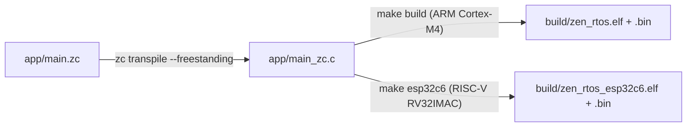

# ZenRTOS User Guide: Build, Flash, Interactive Shell (`zensh`), and Test

This document is the complete operational manual for building, flashing, running the interactive `zensh>` serial shell, and executing the verification suite for **ZenRTOS** across all supported platforms:
1. **Linux Host Verification Suite (`x86_64`)**
2. **STM32L476RG Nucleo-64 (`ARM Cortex-M4F`)**
3. **Waveshare ESP32-C6-Pico (`RISC-V RV32IMAC`)**

---

## 1. Quick Reference Cheat Sheet

| Operation | STM32L476RG (ARM Cortex-M4F) | ESP32-C6-Pico (RISC-V RV32IMAC) | Linux Host (`x86_64`) |
| :--- | :--- | :--- | :--- |
| **Transpile Zen-C (`app/main.zc`)** | `make zenc` | `make zenc` | N/A |
| **Build Firmware (`.elf` + `.bin`)** | `make build` (or `make`) | `make esp32c6` | `make test` |
| **Flash to Non-Volatile Memory** | `make flash` | `make flash-esp32c6` | N/A |
| **Load to RAM Only (Fast Test)** | N/A | `python3 scripts/esp32c6_load.py /dev/ttyACM1 build/zen_rtos_esp32c6.bin --ram` | N/A |
| **Open Interactive Shell (`zensh>`)** | `make shell` (`/dev/ttyACM0`) | `make shell-esp32c6` (`/dev/ttyACM1`) | N/A |
| **Exit Serial Shell (`miniterm`)** | Press **`Ctrl+]`** | Press **`Ctrl+]`** | N/A |
| **Run Unit Test Suite (9 Tests)** | N/A | N/A | `make test` |
| **Clean Build Artifacts** | `make clean` | `make clean` | `make clean` |

---

## 2. Prerequisites & Toolchain

ZenRTOS uses a single unified LLVM/Clang cross-compiler toolchain for both ARM and RISC-V bare-metal targets:

- **Zen-C Compiler (`zc`)**: `/home/mark/code/Zen-C/zc` (transpiles `app/main.zc` with `--freestanding` to `app/main_zc.c`)
- **Cross-Compiler & Linker**: `clang`, `ld.lld`, `llvm-objcopy` (supports both `--target=arm-none-eabi` and `--target=riscv32-unknown-elf`)
- **Host C Compiler**: `gcc` (for the Linux host unit test runner)
- **Flashing & Serial Tools**:
  - `openocd` (`0.12.0+`) for STM32 ST-Link SWD flashing and ESP32-C6 USB-JTAG debugging
  - `python3` + `pyserial` (`python3-serial`) for `scripts/esp32c6_load.py` and `serial.tools.miniterm`

---

## 3. Running the Unit Test Suite (`make test`)

Before flashing hardware, you can verify the core RTOS scheduler, synchronization primitives, IPC message queues, stack canary watermarks, and trace buffer natively on Linux:

```bash
cd ~/projects/zen-rtos
make test
```

### What `make test` Verifies (`tests/host/test_scheduler.c`)
1. **`[TEST 1]` Task Stack Initialization & Alignment**: Verifies initial stack frame synthesis and alignment.
2. **`[TEST 2]` Strict Priority Preemptive Scheduler ($O(1)$)**: Verifies `__builtin_ctz` bitmap selection of the highest-priority ready task.
3. **`[TEST 3]` `rtos_delay()` & Tick Wakeup**: Verifies deterministic sleep-queue decrement and preemption on wakeup.
4. **`[TEST 4]` Mutex Priority Inheritance**: Verifies dynamic priority boosting of a low-priority lock holder and restoration upon `rtos_mutex_unlock()`.
5. **`[TEST 5]` Counting & Binary Semaphores**: Verifies token acquisition, wait-list blocking, and signaling.
6. **`[TEST 6]` Stack Canary (`0xDEADBEEF`) & Overflow Detector**: Verifies per-task stack high-watermark calculation and corruption detection.
7. **`[TEST 7]` Runtime Task Statistics & CPU Load**: Verifies per-task `run_ticks`, `ctx_switches`, and CPU utilization percentage.
8. **`[TEST 8]` Circular Trace Ring Buffer & Fault Analyzer**: Verifies the 64-event lockless trace buffer (`g_trace_buffer`) and fault capture (`g_fault_info`).
9. **`[TEST 9]` Bounded Message Queue (`rtos_queue_t`) IPC**: Verifies thread-safe FIFO ring-buffer producer/consumer messaging.

---

## 4. Building Firmware (`make build` & `make esp32c6`)

Both hardware targets share the **exact same Zen-C application source** (`app/main.zc`) and **core RTOS kernel** (`kernel/rtos.c`).



### 4.1 Build for STM32L476RG (ARM Cortex-M4F)
```bash
make build
```
- **Outputs**:
  - `build/zen_rtos.elf` (ELF with debug symbols for GDB / OpenOCD)
  - `build/zen_rtos.bin` (Raw binary linked for STM32 Flash at `0x08000000`)

### 4.2 Build for ESP32-C6-Pico (RISC-V RV32IMAC)
```bash
make esp32c6
```
- **Outputs**:
  - `build/zen_rtos_esp32c6.elf` (RISC-V RV32IMAC ELF executable)
  - `build/zen_rtos_esp32c6.bin` (Raw binary linked at `0x40800000`)

---

## 5. Flashing to Hardware (`make flash` & `make flash-esp32c6`)

> **Important**: Always close any active `miniterm` serial shell (press **`Ctrl+]`**) before running `make flash-esp32c6`, because flashing and serial monitoring on the ESP32-C6 share `/dev/ttyACM1`.

### 5.1 Flashing STM32L476RG (`make flash`)
Connect the **NUCLEO-L476RG** mini-USB port (ST-Link V2-1) to your PC and run:
```bash
make flash
```
This invokes OpenOCD (`interface/stlink.cfg` + `target/stm32l4x.cfg`) to program `build/zen_rtos.elf` into the STM32's internal 1 MB Flash at `0x08000000`, verify the image, and reset the MCU.

### 5.2 Flashing ESP32-C6-Pico (`make flash-esp32c6`)
Connect the **Waveshare ESP32-C6-Pico** USB-C port (`Espressif USB JTAG/serial debug unit`, `303a:1001`) to your PC and run:
```bash
make flash-esp32c6
```
This runs `scripts/esp32c6_load.py`, which:
1. Resets the ESP32-C6 into ROM Download Mode via USB-Serial DTR/RTS and syncs over SLIP.
2. Wraps `build/zen_rtos_esp32c6.bin` with a bootable 24-byte `0xE9` ESP32-C6 image header (`chip_id = 0x000D`), an 8-byte segment header (`load_addr = 0x40800000`, `entry_addr = 0x40800008`), XOR checksum, and 32-byte SHA-256 digest.
3. Erases and programs the image into **non-volatile 4 MB SPI Flash at offset `0x00000000`**.
4. Hard-resets the board so ZenRTOS boots automatically from SPI Flash and **persists across power cycles**.

#### Optional: Fast RAM-Only Load on ESP32-C6 (No Flash Wear)
During rapid debugging, you can upload directly into 512 KB HP SRAM (`0x40800000`) without writing to SPI Flash:
```bash
python3 scripts/esp32c6_load.py /dev/ttyACM1 build/zen_rtos_esp32c6.bin --ram
```

#### Optional: JTAG Debugging on ESP32-C6 via OpenOCD
A ready-to-use OpenOCD configuration for the ESP32-C6's built-in USB-JTAG interface is provided in `bsp/esp32c6/openocd.cfg`:
```bash
openocd -f bsp/esp32c6/openocd.cfg
```

---

## 6. Running the Interactive Serial Shell (`zensh>`)

ZenRTOS includes a built-in interactive command-line shell (**`zensh v1.2`**) running as an RTOS task (`Priority 6`).

### 6.1 Opening the Shell

- **On STM32L476RG (`/dev/ttyACM0` @ `115200 8N1`)**:
  ```bash
  make shell
  ```
- **On ESP32-C6-Pico (`/dev/ttyACM1` @ USB-Serial/JTAG)**:
  ```bash
  make shell-esp32c6
  ```
  *(Note: If only one board is plugged into your PC, check `ls /dev/ttyACM*`—the single board may enumerate as `/dev/ttyACM0`, in which case you can run `python3 -m serial.tools.miniterm --eol CR /dev/ttyACM0 115200`.)*

### 6.2 How to Exit the Serial Shell
`make shell` and `make shell-esp32c6` use Python's `miniterm`.
- To **exit `miniterm`** and return to your Linux bash prompt: press **`Ctrl+]`** (Control + right bracket).

### 6.3 Available `zensh>` Commands

Once connected, press `Enter` to see the `zensh>` prompt. As soon as you start typing a command, periodic telemetry output automatically pauses until you press `Enter`.

| Command | Description |
| :--- | :--- |
| **`help`** (or `?`) | Display all available `zensh>` commands |
| **`ps`** (or `top`) | Print live task table: Task ID, Name, State (`READY`/`BLOCKED`), Priority, `RunTicks`, `CtxSw`, and free stack bytes |
| **`log off`** (or `quiet`) | Stop the 1 Hz automatic telemetry printout for a clean interactive session |
| **`log on`** | Resume the 1 Hz automatic telemetry printout |
| **`trace`** | Dump the last 12 events from the 64-entry circular kernel trace buffer (`TASK_SWITCH`, `TASK_DELAY`, `TASK_WAKE`, `SEM_WAIT`, `SEM_SIGNAL`, `QUEUE_SEND`, `QUEUE_RECV`) |
| **`sensor`** (or `temp`, `queues`) | Show the latest simulated sensor temperature (`C`), bounded IPC message queue count (`msgs`), and LED status |
| **`mem`** (or `stack`) | Verify all task stack canaries (`0xDEADBEEF`) and report any stack overflow |
| **`led on`** / **`led off`** | Manually turn the onboard LED (`PA5` on STM32, `GPIO8` WS2812B RGB on ESP32-C6) ON or OFF |
| **`led toggle`** | Manually toggle the onboard LED state |
| **`led red`** / **`led green`** / **`led blue`** | *(ESP32-C6-Pico)* Change the onboard WS2812B-0807 RGB NeoPixel LED color (`0xRRGGBB`) |
| **`led blink`** | Return the LED to automatic 1 Hz RTOS task blinking (`BlinkLED` task) |
| **`fault`** | Inspect post-mortem hardware fault registers (`CFSR`/`HFSR`/`MMFAR`/`BFAR` on ARM Cortex-M4; `MCAUSE`/`MEPC`/`MTVAL`/`MSTATUS` on RISC-V) |
| **`uptime`** | Display system uptime in seconds (`s`) and raw millisecond ticks |
| **`clear`** (or `cls`) | Clear the terminal screen |

### 6.4 Example Interactive Session

```text
========================================================
  ZenRTOS Interactive Shell (zensh v1.2) - ESP32-C6-Pico
  Type 'help' for available RTOS inspection commands.   
  Type 'log off' to stop periodic telemetry printout.   
========================================================
zensh> log off
Periodic telemetry broadcast DISABLED.
zensh> ps

=== [ZenRTOS ESP32-C6 Telemetry] Tick: 17461 ms | CPU Load: 1% | CtxSw: 3803 | Temp: 27C ===
  ID  Name        State    Prio  RunTicks  CtxSw  StackFree
  --  ----------  -------  ----  --------  -----  ---------
  #1  Idle        READY    31    17240     1889   348/512B
  #2  Sensor      BLOCKED  5     0         88     836/1024B
  #3  Shell       READY    6     1         1747   752/1024B
  #4  Telemetry   BLOCKED  8     220       18     704/1024B
  #5  BlinkLED    BLOCKED  10    0         35     852/1024B
zensh> led blue
WS2812 RGB LED color set to BLUE.
zensh> led blink
WS2812 RGB LED (GPIO8) returned to automatic 1 Hz RTOS blink.
zensh> mem
Stack Canary Check (0xDEADBEEF): PASS (All task stacks intact)
```
