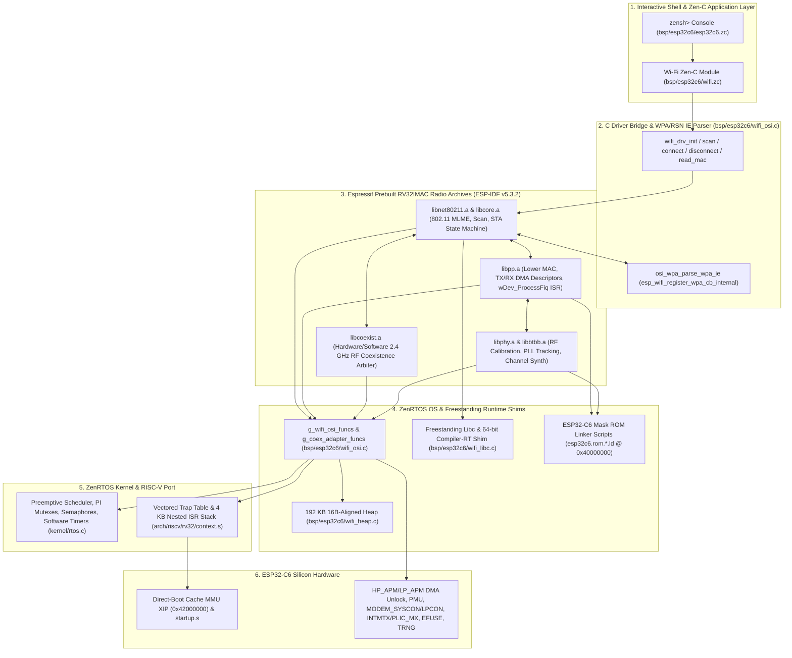
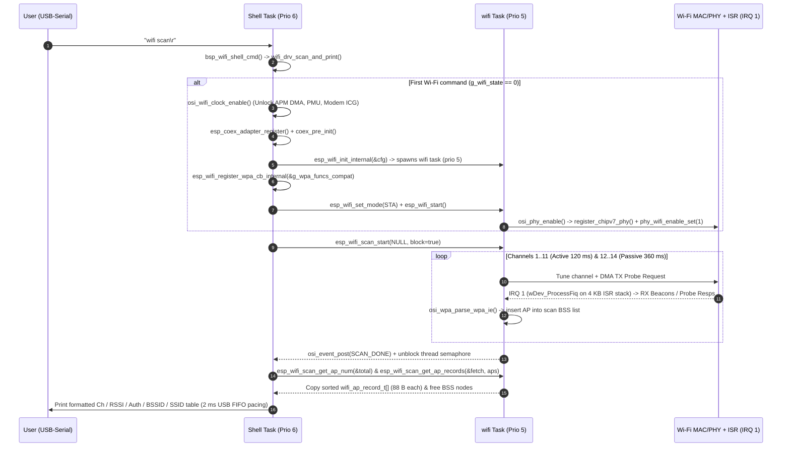

# ESP32-C6 Bare-Metal Wi-Fi Code Architecture in ZenRTOS

**Target Hardware:** Waveshare ESP32-C6-Pico (`ESP32-C6-MINI-1`, RISC-V `RV32IMAC` @ 160 MHz, 512 KB HP SRAM, 4 MB SPI Flash)  
**Languages:** Zen-C (`.zc`), Freestanding C11 (`.c`), RISC-V Assembly (`.s`)  
**Toolchain:** Zen-C Transpiler (`zc`) + LLVM/Clang (`--target=riscv32-unknown-elf -nostdlib -fuse-ld=lld`)  
**Zero External OS Dependencies:** Runs directly on the ZenRTOS microkernel — **no ESP-IDF runtime, no FreeRTOS, no Newlib**

---

## 1. Architectural Overview

Espressif's ESP32-C6 integrates a 2.4 GHz Wi-Fi 6 (`802.11b/g/n/ax`), BLE 5, and IEEE 802.15.4 combo radio whose MAC, baseband, and RF calibration register maps are closed-source. To run real over-the-air Wi-Fi natively on ZenRTOS without pulling in ESP-IDF or FreeRTOS, the subsystem is structured into **six clean layers**:



---

## 2. File & Component Inventory

| File / Directory | Role in the Architecture |
| :--- | :--- |
| `bsp/esp32c6/wifi.zc` | Zen-C command dispatcher (`bsp_wifi_shell_cmd`) implementing `wifi mac`, `wifi scan`, `wifi connect`, `wifi status`, and `wifi disconnect`, plus hex/MAC formatting helpers. |
| `bsp/esp32c6/esp32c6.zc` | Core ESP32-C6 BSP in Zen-C: 160 MHz SPLL clock select, watchdog unlock/disable, CLINT 1 kHz tick timer, USB-Serial/JTAG console, WS2812B LED driver, and `zensh>` hook delegating `wifi ...` commands to `bsp_wifi_shell_cmd()`. |
| `bsp/esp32c6/wifi_osi.c` | Central C integration layer (~1,080 LOC): hardware APM/PMU/modem clock bring-up, `INTMTX`/`PLIC_MX` interrupt routing, byte-payload queues, event groups, `ETSTimer` side-table, `g_coex_adapter_funcs`, `g_wifi_osi_funcs`, RSN/WPA IE parser, and high-level `wifi_drv_*` functions. |
| `bsp/esp32c6/wifi_heap.c` | Deterministic 192 KB 16-byte-aligned free-list allocator (`wifi_heap_malloc`, `calloc`, `realloc`, `free`, `free_bytes`) in HP SRAM with block splitting, adjacent coalescing, `0x5A454E48` (`"ZENH"`) header magic, and `rtos_irq_save()` protection. |
| `bsp/esp32c6/wifi_libc.c` | Minimal freestanding C library (`memcpy`, `memmove`, `memset`, `memcmp`, `strlen`, `strncpy`, `vsnprintf` with width/zero-padding, `printf`/`ets_printf`/`phy_printf`/`coexist_printf`) and 64-bit integer runtime helpers (`__udivdi3`, `__umoddi3`, `__divdi3`, `__moddi3`, `__ashldi3`, `__lshrdi3`, `__ashrdi3`) so Clang `-nostdlib` links GCC-built `.a` archives cleanly. |
| `bsp/esp32c6/link_wifi.ld` | Direct-Boot XIP linker script placing code/rodata in cache-mapped Flash (`0x42000000`) and copying latency-critical ISR/Wi-Fi/PHY/Coex IRAM sections + `.data` into `496 KB` HP SRAM (`0x40800000..0x4087C000`). |
| `bsp/esp32c6/startup.s` | Emits the `0xAEDB041D, 0xAEDB041D` Direct-Boot header, initializes `gp` (`__global_pointer$`) and `sp`, copies `.iram1` and `.data` from Flash XIP to HP SRAM, executes `fence.i`, zeroes `.bss`, and enters `main()`. |
| `arch/riscv/rv32/context.s` | 32-entry 256-byte-aligned RISC-V vectored trap table (`_mtvec_table`), 4 KB dedicated nested interrupt stack (`g_isr_stack`), `MSIP` context switcher, `MTIMER` tick handler, and external `PLIC_MX` IRQ dispatcher. |
| `kernel/rtos.c` & `rtos.h` | Preemptive priority + round-robin scheduler, IRQ-state-saving critical sections (`rtos_irq_save`/`restore`), priority-inheritance recursive mutexes, ISR-safe semaphores (`rtos_sem_signal_from_isr`), dynamic task deletion (`rtos_task_delete`), and software timer wheel (`rtos_timer_t`). |
| `scripts/fetch_esp32c6_wifi_blobs.sh` | Downloads pinned ESP-IDF `v5.3.2` static archives (`libnet80211.a`, `libpp.a`, `libcore.a`, `libcoexist.a`, `libphy.a`, `libbtbb.a`), ROM symbol scripts (`esp32c6.rom.*.ld`), and headers into gitignored `third_party/esp32c6_wifi/`. |
| `scripts/esp32c6_load.py` | Pure-Python SLIP serial ROM loader supporting `--raw-flash` to program `zen_rtos_esp32c6_wifi.bin` directly at SPI Flash `0x00000000` for hardware Direct-Boot XIP. |

---

## 3. Boot Flow & Memory Architecture (Hardware Direct-Boot XIP)

### 3.1 Why Direct-Boot XIP (`0xAEDB041D`)
The base non-Wi-Fi ZenRTOS image (`make esp32c6`) is only ~19 KB and fits entirely inside SRAM via a standard `0xE9` ROM bootloader image. With the Wi-Fi 6 and PHY archives linked, the image grows to **~360 KB**, exceeding single-segment SRAM boot limits while the 1st-stage mask ROM bootloader does **not** set up Cache MMU Flash XIP mappings for `0xE9` images without a 2nd-stage bootloader.

Instead, `make esp32c6-wifi` leverages ESP32-C6's hardware **Direct-Boot XIP** feature:
1. `bsp/esp32c6/startup.s` places two magic words (`0xAEDB041D, 0xAEDB041D`) at offset `+0x00` (`.direct_boot_header`) and `_start` at offset `+0x08`.
2. `scripts/esp32c6_load.py --raw-flash` writes the flat binary raw to SPI Flash `0x00000000`.
3. On reset, the ESP32-C6 mask ROM detects `0xAEDB041D`, configures the unified Cache MMU to map SPI Flash `0x00000000..0x003FFFFF` 1:1 into **`0x42000000..0x423FFFFF`**, and jumps straight to `0x42000008` (`_start`).
4. `_start` disables interrupts, loads `gp` (`__global_pointer$ = _sdata + 0x800` with `.option norelax`) and `sp = _estack` (`0x4087C000`), copies `.iram1` and `.data` from their `0x420xxxxx` Flash LMAs into `0x40800000` HP SRAM, runs `fence.i` to synchronize the instruction stream, installs `_mtvec_table | 1` into `mtvec`, zeroes `.bss`, disables watchdogs, and calls `main()`.

### 3.2 Memory Map (`bsp/esp32c6/link_wifi.ld`)

```text
SPI Flash XIP (0x42000000 .. 0x423FFFFF, 4 MB Cache-Mapped)
┌──────────────────────────────────────────────────────────────────────────┐
│ 0x42000000  .direct_boot_header (8 B: 0xAEDB041D, 0xAEDB041D)            │
│ 0x42000008  .text & .rodata (~290 KB)                                    │
│             - _start, ZenRTOS kernel, Zen-C app & BSP, wifi_osi.c        │
│             - Cold code & .rodata/.rodata.wdev* of libnet80211/pp/phy    │
│             - LMA image of .iram1 and .data                              │
└──────────────────────────────────────────────────────────────────────────┘

ESP32-C6 High-Performance SRAM (0x40800000 .. 0x4087FFFF, 512 KB Total)
┌──────────────────────────────────────────────────────────────────────────┐
│ 0x40800000  .iram1 (~60 KB, 256-byte aligned, RWX)                       │
│             - _mtvec_table (32 vectored trap entries)                    │
│             - context.s, .wifi0iram.*, .wifirxiram.*, .wifiextrairam.*   │
│             - .wifislpiram.*, .phyiram.*, .coexiram.*                    │
├──────────────────────────────────────────────────────────────────────────┤
│             .data + .sdata + .got (~10 KB, __global_pointer$ centered)   │
├──────────────────────────────────────────────────────────────────────────┤
│             .bss + .sbss (~270 KB NOLOAD)                                │
│             - Blob static state (g_ic, MAC/BB descriptors, PHY tables)   │
│             - ZenRTOS TCB array, software timer wheel, trace ring        │
│             - g_isr_stack (4 KB, 16-byte aligned)                        │
│             - g_wifi_heap_arena (192 KB, 16-byte aligned DMA-capable)    │
├──────────────────────────────────────────────────────────────────────────┤
│   ...       Free Headroom & Boot Stack (grows down from 0x4087C000)      │
├──────────────────────────────────────────────────────────────────────────┤
│ 0x4087C000  Top 16 KB Reserved for ESP32-C6 Mask ROM Data/BSS            │
└──────────────────────────────────────────────────────────────────────────┘
```

> **Linker Critical Detail:** Every custom hot-path section emitted by Espressif's archives (`.wifi0iram.*`, `.wifirxiram.*`, `.phyiram.*`, `.coexiram.*`) **must** be explicitly captured inside `.iram1 > SRAM AT > FLASH`. Leaving an orphan section unmapped causes `lld` to place it at VMA `0x408xxxxx` without `AT > FLASH`, creating a 25 MB gap in `llvm-objcopy -O binary`.

---

## 4. Silicon Radio Bring-Up Sequence

Because ZenRTOS boots directly from the mask ROM without ESP-IDF's 2nd-stage bootloader or `SystemInit`, `bsp/esp32c6/wifi_osi.c` performs the complete hardware power, bus permission, clock gating, PHY calibration, and coexistence initialization sequence in deterministic order:

### Step 1: Unlock APM Bus Filters for Wi-Fi MAC DMA (`bsp_bbpll_480m_init_and_pmu_modem_on`)
On ESP32-C6 silicon, the **Access Permission Management (`HP_APM`, `LP_APM0`, `LP_APM`)** controllers reset to an enabled state that only permits Trusted Execution Environment (TEE) accesses from the HP CPU while blocking all REE bus masters. Without clearing these filters, CPU-driven PHY loopback calibration succeeds, yet the **Wi-Fi MAC DMA engine cannot read TX descriptors or write RX frames in HP SRAM** (resulting in `0` packets transmitted or received over the air).
- Writes `0` to `HP_APM_FUNC_CTRL_REG` (`0x600990C4`), `LP_APM0_FUNC_CTRL_REG` (`0x600998C4`), and `LP_APM_FUNC_CTRL_REG` (`0x600B38C4`).

### Step 2: PMU Power Domain, BBPLL & Immediate ICG Latching
- Calls ROM `ets_update_cpu_frequency(160)` so `esp_rom_delay_us()` busy-loops inside `libphy.a` time accurately at 160 MHz.
- Clears force power-down/isolate/reset on the Wi-Fi power domain (`PMU_POWER_PD_HPWIFI_CNTL_REG = 0`, `PMU_HP_ACTIVE_DIG_POWER_REG &= ~(1 << 27)`).
- Enables `XPD_BB_I2C | XPD_BBPLL_I2C | XPD_BBPLL` in `PMU_HP_ACTIVE_HP_CK_POWER_REG` (`0x600B0014`) and sets `PMU_HP_ACTIVE_ICG_MODEM_REG = (2UL << 30)` (`PMU_HP_ICG_MODEM_CODE_ACTIVE = 2`).
- Pulses the write-trigger bits in `PMU_IMM_HP_CK_POWER_REG`, `PMU_IMM_HP_FUNC_ICG_REG`, `PMU_IMM_HP_APB_ICG_REG`, `PMU_IMM_MODEM_ICG_REG`, and `PMU_IMM_SLEEP_SYSCLK_REG` (`PMU_UPDATE_DIG_ICG_SWITCH`) so the PMU immediately latches the active clock-gating state.
- Releases `PMU_PERIF_I2C_RSTB | PMU_XPD_PERIF_I2C` in `PMU_RF_PWC_REG` (`0x600B0154`), enables PLL dividers (`PCR_PLL_DIV_CLK_EN_REG`), and ungates the 160 MHz internal analog `REGI2C` master (`MODEM_LPCON_I2C_MST_CLK_REG`, `ANA_CONFIG_REG`, `ANA_CONFIG2_REG`).

### Step 3: Modem Clock Domain ICG Bitmaps & LP Clocks (`osi_wifi_clock_enable`)
Each modem clock domain in `MODEM_SYSCON` and `MODEM_LPCON` uses a 4-bit power-state bitmap (`BIT(0)=SLEEP`, `BIT(1)=MODEM`, `BIT(2)=ACTIVE`) that resets to `0x0` (all clocks gated).
- `MODEM_SYSCON_CLK_POWER_ST_REG` (`0x600A980C`) `|= 0x64646400` — ungates `MODEM_APB`, `WIFI`, and `MODEM_FE` in `ACTIVE | MODEM` (`0x6`), and `MODEM_PERIPH`, `BT`, `IEEE802154` in `ACTIVE` (`0x4`). This allows `libphy.a` to dynamically toggle high-speed 480 MHz and analog-mode front-end clocks in `CLK_CONF1[23:19]`.
- `MODEM_LPCON_CLK_POWER_ST_REG` (`0x600AF020`) `|= 0x66660000` — ungates `LP_APB`, `I2C_MST`, `COEX`, and `WIFIPWR` in `ACTIVE | MODEM`.
- `MODEM_SYSCON_CLK_CONF1_REG` (`0x600A9814`) `|= 0x0001E7FF` — enables `WIFIBB` (`22M/40M/44M/80M/40X/80X/40X1/80X1/160X1`), `WIFIMAC`, `WIFI_APB`, and PHY front-end (`FE_80M`, `FE_160M`, `FE_CAL_160M`, `FE_APB`) clocks while preserving `CLK_DATA_DUMP_MUX` in `CLK_CONF`.
- Selects the internal ~136 kHz `OSC_SLOW` (`RC_SLOW`, `div = 0`) source for both `MODEM_LPCON_WIFI_LP_CLK_REG` (`0x600AF00C`) and `MODEM_LPCON_COEX_LP_CLK_REG` (`0x600AF008`), enables `WIFIPWR | COEX | I2C_MST` in `MODEM_LPCON_CLK_CONF_REG`, and calls ROM `coex_hw_clear_reg()`.

### Step 4: Combo-Mode PHY RF Calibration & Coexistence Arbiter (`osi_phy_enable` & `wifi_drv_init`)
1. Registers `g_coex_adapter_funcs` (`_version = 2`, `_magic = 0xDEADBEAF`) via `esp_coex_adapter_register()` and runs `coex_pre_init()` so the hardware coexistence arbiter grants 2.4 GHz antenna/PTI access (`WDEVAX_PTI0 = 0x55777555`, `WDEVAX_PTI1 = 0x3377`).
2. When `esp_wifi_start()` invokes `osi_phy_enable()`:
   - Calls `phy_init_param_set(1)` (required because ESP32-C6 is a combo Wi-Fi/BLE/15.4 radio) and `phy_bbpll_en_usb(true)` (keeps the 48 MHz USB-Serial/JTAG tap alive during RF calibration).
   - Allocates `esp_phy_calibration_data_t`, populates the factory eFuse MAC, and runs full RF calibration via `register_chipv7_phy(&phy_init_data, cal_data, PHY_RF_CAL_FULL)`.
   - Calls `bt_track_pll_cap()` and `phy_wifi_enable_set(1)` to switch the combo front-end into active Wi-Fi TX/RX mode.
   - Re-asserts `MODEM_LPCON_CLK_CONF_REG |= 0x7` and `MODEM_LPCON_CLK_FORCE_REG |= (1 << 1)` (`CLK_COEX_FO`) because `libphy.a` clears `CLK_COEX_EN` during calibration.
3.Note on MAC Reset (`osi_wifi_reset_mac`): resets **only** `RST_WIFIMAC` (`BIT(10)` of `MODEM_SYSCON_RST_CONF_REG`), never `RST_WIFIBB` (`BIT(8)`), preserving baseband calibration tables written by `libphy.a`.

---

## 5. Interrupt Routing & 4 KB Nested ISR Stack

### 5.1 `INTMTX` + `PLIC_MX` Routing Without CLINT Collisions
ESP32-C6 uses a 32-slot vectored `mtvec` table where slots `0` (synchronous exceptions), `3` (`CLINT MSIP` context switch), `4`, and `7` (`CLINT MTIMER` 1 kHz tick) are reserved.
- `libpp.a` requests CPU interrupt `1` (`ETS_WMAC_INUM = 1`) for both `WIFI_MAC_INTR_SOURCE` (`0`) and `WIFI_PWR_INTR_SOURCE` (`2`) at priority `1`.
- `remap_irq_num()` deterministically remaps reserved slots (`0 -> 9`, `3 -> 10`, `4 -> 11`, `7 -> 12`) while leaving valid peripheral slots such as `1` untouched.
- `osi_set_intr()` calls ROM `esp_rom_route_intr_matrix()`, `esprv_intc_int_set_type(hw_num, 0)` (level-triggered), `esprv_intc_int_set_priority(hw_num, prio)`, and **`esprv_intc_int_set_threshold(0)`** (allowing priority `1` interrupts through `PLIC_MX`).

### 5.2 Dedicated 4 KB ISR Stack (`arch/riscv/rv32/context.s`)
`libpp.a`'s `wDev_ProcessFiq` Wi-Fi MAC interrupt handler uses ~1.5–2 KB of stack space — far more than lightweight RTOS tasks (`Idle` = 512 B, `Sensor` = 1 KB).
- On entry to `riscv_ext_irq_handler` or `riscv_mtimer_handler`, `SAVE_CONTEXT` pushes the 32-word (128 B) register frame onto the interrupted stack.
- `ENTER_ISR_STACK` atomically increments `g_isr_nest_depth`. On the outermost interrupt (`0 -> 1`), it saves `sp` to `current_tcb->sp` and switches `sp` to `_isr_stack_top` (`g_isr_stack + 4096`).
- `bsp_riscv_ext_irq_dispatch(mcause & 0x1F)` invokes the registered `libpp.a` ISR (`g_ext_isr_fn[irq_num]`).
- On exit, `EXIT_ISR_STACK` decrements `g_isr_nest_depth`. When returning to `0`, if the ISR woke the higher-priority `wifi` task (`next_tcb != NULL`), it switches `current_tcb = next_tcb` immediately and clears any pending `CLINT MSIP` (`0x20001800 = 0`), restoring `sp` from the newly scheduled task with zero extra trap overhead.

---

## 6. OS Integration Layer (`wifi_osi_funcs_t`) & Scan Execution Flow

### 6.1 Mapping Espressif OS Primitives to ZenRTOS

| `wifi_osi_funcs_t` Group | ZenRTOS Implementation Details |
| :--- | :--- |
| **Critical Sections** | `_wifi_int_disable` / `_wifi_int_restore` and `phy_enter_critical` / `phy_exit_critical` map directly to `rtos_irq_save()` (`csrrci %0, mstatus, 0x8`) and `rtos_irq_restore(flags)` (`csrw mstatus, %0`), safely supporting arbitrary nesting inside tasks and ISRs. |
| **Tasks & Priority Mapping** | `osi_task_create_pinned()` allocates the requested stack from `wifi_heap_malloc()` and inverts ESP-IDF priorities (`higher = more urgent`, `prio = 23` for the `wifi` driver task) into ZenRTOS priorities (`lower = more urgent`, `zprio = 28 - prio = 5`) via `rtos_task_create_ex()`. |
| **IPC Thread Semaphores** | Synchronous Wi-Fi API calls (`esp_wifi_init_internal`, `esp_wifi_start`, `esp_wifi_scan_start`, `esp_wifi_scan_get_ap_records`) post an ioctl message to the `wifi` task queue and block on `_wifi_thread_semphr_get()`, backed by per-task `g_wifi_thread_sems[cur->id]`. |
| **Mutexes & Semaphores** | `_mutex_create` and `_recursive_mutex_create` use ZenRTOS's recursive priority-inheritance `rtos_mutex_t`. `_semphr_give` automatically dispatches `rtos_sem_signal_from_isr()` when `g_isr_nest_depth > 0`. |
| **Generic & Static Queues** | `osi_queue_t` implements arbitrary `item_size * capacity` byte-ring buffers synchronized with two counting semaphores (`items_avail`, `slots_free`). `_wifi_create_queue` wraps `osi_queue_t*` inside a `wifi_static_queue_compat_t` struct whose first field is `handle`, matching ESP-IDF's `wifi_static_queue_t` ABI. |
| **Opaque `ETSTimer` Side-Table** | `libnet80211`, `libpp`, and `libcoexist` pass internal `ETSTimer` structs whose fields they also read directly. Rather than overwriting `ETSTimer` memory, `s_timer_slots[48]` maps each `ETSTimer*` key to a dedicated `rtos_timer_t` serviced by ZenRTOS's high-priority `SysTimer` task. |
| **Monotonic Clock & Entropy** | `bsp_timer_get_us()` reads the 64-bit `CLINT MTIME` register atomically (hi-lo-hi loop) and divides by `160` for exact `1 us` timestamps. `_rand` / `_get_random` read hardware entropy from `LP_WDEV_RNG_DATA_REG` (`0x600B2800`). |
| **WPA/RSN IE Callback** | `esp_wifi_register_wpa_cb_internal(&g_wpa_funcs_compat)` registers `osi_wpa_parse_wpa_ie` (at slot `15` of `struct wpa_funcs`) plus safe STA lifecycle stubs so `libnet80211.a` parses IEEE 802.11i RSN (`0x30`) and WPA1 (`0xDD`) information elements and retains WPA2/WPA3 APs in its scan BSS list. |

### 6.2 End-to-End `zensh> wifi scan` Sequence



---

## 7. Build, Link & Flash Pipeline

```bash
# 1. One-time fetch of pinned ESP-IDF v5.3.2 static archives, ROM .ld scripts & headers
./scripts/fetch_esp32c6_wifi_blobs.sh

# 2. Transpile Zen-C (main.zc, esp32c6.zc, wifi.zc) and compile + link Direct-Boot XIP ELF/BIN
make esp32c6-wifi

# 3. Flash raw Direct-Boot XIP binary to SPI Flash @ 0x00000000 and reboot
make flash-esp32c6-wifi

# 4. Open interactive zensh> serial console
make shell-esp32c6
```

Under the hood, `make esp32c6-wifi`:
1. Invokes `zc transpile --freestanding` on `app/main.zc`, `bsp/esp32c6/esp32c6.zc`, and `bsp/esp32c6/wifi.zc`, post-processing module-static collisions so multi-file Zen-C builds link cleanly.
2. Compiles `kernel/rtos.c`, `arch/riscv/rv32/context.s`, `bsp/esp32c6/startup.s`, `wifi_heap.c`, `wifi_libc.c`, `wifi_osi.c`, and `phy_init_data.c` with `clang --target=riscv32-unknown-elf -march=rv32imac_zicsr_zifencei -mabi=ilp32 -mcmodel=medany -O2 -ffreestanding -nostdlib -fuse-ld=lld`.
3. Links against `bsp/esp32c6/link_wifi.ld`, the eight `esp32c6.rom.*.ld` Mask ROM symbol scripts (`0x40000000`), and `--start-group libnet80211.a libpp.a libcore.a libcoexist.a libphy.a libbtbb.a --end-group --gc-sections` to produce `build/zen_rtos_esp32c6_wifi.bin` (~360 KB).
