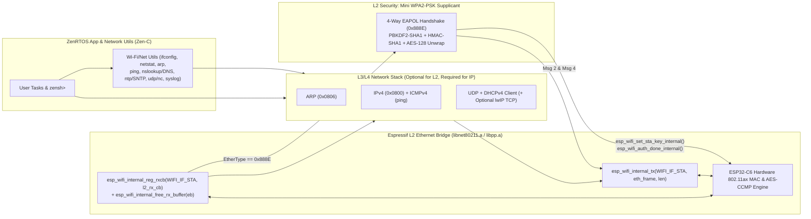

# Engineering Plan: ESP32-C6 Wi-Fi AP Association, WPA2-PSK & Networking in ZenRTOS

This document answers how a ZenRTOS application connects to a Wi-Fi Access Point (AP) and exchanges data on the **ESP32-C6**, clarifies **when an IP stack is (and is not) required**, and defines a concrete, phased implementation plan.

---

## 1. How Wi-Fi Connection & Data Communication Work on ESP32-C6

In our bare-metal ESP32-C6 architecture (`libnet80211.a` + `libpp.a` + `libphy.a` + `libcoexist.a`), `libnet80211.a` does **not** speak IP — once connected to an AP, it bridges **standard IEEE 802.3 Ethernet II frames** (`[Dst MAC 6B][Src MAC 6B][EtherType 2B][Payload]`) to and from encrypted 802.11ax Wi-Fi frames in hardware:



### The Two Halves of End-to-End Wi-Fi Communication

1. **Link Establishment (L2 Association + WPA2-PSK Authentication)**:
   - **Open AP (`WIFI_AUTH_OPEN`)**: `esp_wifi_connect_internal()` -> `wpa_sta_connect()` -> `esp_wifi_sta_connect_internal(bssid)` performs 802.11 Probe, Authentication, and Association, then immediately opens the L2 data port.
   - **WPA2-PSK AP (`WIFI_AUTH_WPA2_PSK`)**: After 802.11 Association, the router blocks normal traffic until the **IEEE 802.11i 4-Way EAPOL-Key Handshake** (`EtherType = 0x888E`) completes:
     1. Derive the 32-byte Pairwise Master Key: `PMK = PBKDF2-HMAC-SHA1(passphrase, ssid, 4096, 32)`.
     2. Receive **EAPOL Message 1** (`ANonce` from AP), generate a random 32-byte `SNonce` from hardware TRNG, compute the 48-byte `PTK` (`KCK[16] | KEK[16] | TK[16]`) via `PRF-384`, and transmit MIC-signed **EAPOL Message 2**.
     3. Receive **EAPOL Message 3**, verify the `HMAC-SHA1` (or `AES-128-CMAC` for PMF/SHA256 AKM) MIC using `KCK`, decrypt/unwrap the broadcast Group Temporal Key (`GTK`) using `KEK` (`RFC 3394 AES Key Unwrap`), transmit **EAPOL Message 4**, program `TK` + `GTK` into the ESP32-C6 hardware AES-CCMP engine via `esp_wifi_set_sta_key_internal()`, and call `esp_wifi_auth_done_internal()`.

2. **Packet TX / RX Data Plane (L2 Ethernet Bridge)**:
   - **Receiving packets**: Register a callback with `esp_wifi_internal_reg_rxcb(WIFI_IF_STA, wifi_l2_rx_cb)`. Every decrypted frame arrives as a contiguous `uint8_t *buffer` starting with `[dst_mac(6)][src_mac(6)][ethertype_be16(2)][payload...]`, accompanied by an opaque `void *eb` handle that must be returned via `esp_wifi_internal_free_rx_buffer(eb)`.
   - **Transmitting packets**: Build an Ethernet II frame in RAM and pass it to `esp_wifi_internal_tx(WIFI_IF_STA, frame, len)`.

---

## 2. Does an Application Need an IP Stack?

**Short answer:** **No** for raw L2 / ESP-NOW device-to-device links, **Yes** to talk to home routers, phones, cloud servers, or standard PC sockets (`ping`, UDP, TCP, HTTP, MQTT).

| Use Case | IP Stack Needed? | How It Communicates |
| :--- | :--- | :--- |
| **ESP-NOW** (ESP32 <-> ESP32 direct telemetry/control) | **No** (doesn't even need an AP) | Vendor-specific 802.11 Action frames at L2. |
| **Raw L2 Ethernet over Wi-Fi** (ESP32-C6 <-> Linux PC on same LAN via `AF_PACKET`) | **No** | Send/receive Ethernet II frames with custom `EtherType` (e.g., `0x88B5`) directly via `esp_wifi_internal_tx` / `rxcb`. |
| **LAN Telemetry, `ping`, NTP, CoAP, Syslog, Discovery** | **Yes — Micro UDP/IPv4 Stack (~8 KB RAM)** | Needs **ARP + IPv4 + ICMPv4 + DHCPv4 + UDP**. Trivial to implement cleanly in ~800 LOC with zero external dependencies. |
| **HTTP/REST, MQTT, WebSockets, TLS** | **Yes — Full TCP/IP Stack (`lwIP`, ~32 KB RAM)** | Needs sliding-window **TCP**, congestion control, retransmissions, and DNS (`lwIP` `NO_SYS=0` or `NO_SYS=1`). |

### Recommended Strategy for ZenRTOS: Native Micro-IP First, Optional `lwIP` Second
- **Memory Headroom**: `zen_rtos_esp32c6_wifi.elf` currently uses `~292 KB` of `496 KB` usable HP SRAM (with **`~165 KB` free** inside the 192 KB Wi-Fi heap and `>200 KB` total SRAM headroom), so **either** option fits comfortably.
- **Architectural Fit**: Building a clean, zero-dependency **ZenNet Micro-IPv4 stack** (`ARP` + `IPv4` + `ICMPv4 ping` + `DHCPv4` + `UDP` Zen-C API) first keeps ZenRTOS 100% self-contained, fast to compile, and easy to audit — while designing the L2 driver boundary (`wifi_drv_eth_tx` / `wifi_drv_eth_rx`) so **`lwIP`** can also be attached later if TCP is needed.

---

## 3. Phased Implementation Plan

### Phase 1: Open AP & WPA2-PSK Association (`wifi connect <ssid> [pass]`)

#### 1.1 Freestanding Crypto Primitives (`bsp/esp32c6/wifi_wpa2.c`, ~250 LOC)
Implement compact, table-free freestanding C routines (only used during connect, placed in Flash XIP `.text` so **zero `.iram1` cost**):
- `sha1_vector()` & `hmac_sha1()` / `hmac_sha1_vector()`
- `pbkdf2_sha1()` (4096 iterations -> 32-byte `PMK`; takes ~35 ms at 160 MHz on ESP32-C6)
- `wpa_prf()` (IEEE 802.11i `PRF-384` for `PTK` derivation)
- `aes128_encrypt_block()` & `aes_unwrap()` (RFC 3394 128-bit KEK unwrap for `GTK` in EAPOL Msg 3)

#### 1.2 Minimal WPA2-PSK STA State Machine (`bsp/esp32c6/wifi_wpa2.c` + `wifi_osi.c`, ~250 LOC)
Wire the remaining callbacks in `g_wpa_funcs_compat`:
1. **`wpa_sta_connect(uint8_t *bssid)`**:
   - Reads configured SSID/passphrase; if passphrase is non-empty, pre-computes `PMK` (caching `(ssid, pass) -> PMK` so reconnects are instant), formats our RSN IE (`WPA2-PSK CCMP`), and calls `esp_wifi_sta_connect_internal(bssid)`.
2. **`wpa_sta_rx_eapol(uint8_t *src_addr, uint8_t *buf, uint32_t len)`**:
   - **On Message 1 (`Key Info: Pairwise=1, Ack=1, Mic=0`)**:
     - Captures `ANonce[32]`, generates `SNonce[32]` via hardware TRNG (`LP_WDEV_RNG_DATA_REG`), derives `PTK` (`KCK`, `KEK`, `TK`), builds **Message 2** carrying our RSN IE + `SNonce`, signs MIC (`HMAC-SHA1(KCK, msg2)`), and sends via `esp_wifi_internal_tx(WIFI_IF_STA, eth_frame, frame_len)`.
   - **On Message 3 (`Key Info: Pairwise=1, Install=1, Ack=1, Mic=1, Secure=1`)**:
     - Verifies `HMAC-SHA1` MIC and replay counter, decrypts Key Data via `aes_unwrap(KEK, ...)` (and/or AES-128-CBC for WPA1/mixed), extracts `GTK` + Key Index, sends MIC-signed **Message 4**, installs pairwise `TK` and group `GTK` via `esp_wifi_set_sta_key_internal()`, and calls `esp_wifi_auth_done_internal()`.
3. **Event & State Tracking (`osi_event_post`)**:
   - Track `WIFI_EVENT_STA_CONNECTED` (`id = 4`) and `WIFI_EVENT_STA_DISCONNECTED` (`id = 5`, recording disconnect reason code) and register the L2 RX callback `esp_wifi_internal_reg_rxcb(WIFI_IF_STA, wifi_l2_rx_cb)` upon association.

---

### Phase 2: ZenNet Micro-IPv4 Stack (`ARP + IPv4 + DHCPv4 + ICMPv4 + UDP`)

Create a clean, portable network module (`net/net.c` + `net/include/net.h` + Zen-C bindings in `bsp/esp32c6/wifi.zc`) sitting atop `wifi_drv_eth_tx(frame, len)` and `wifi_l2_rx_cb(frame, len)`:

```text
net/
├── include/
│   ├── zen_net.h        # Core L3/L4 API (DHCP, ARP, ICMPv4, UDP sockets, counters)
│   └── zen_net_utils.h  # Utilities API (IPv4 parse/format, DNS, SNTP, UDP syslog)
├── zen_net.c            # ~750 LOC: Ethernet II demux, ARP cache, IPv4, ICMPv4, DHCPv4, UDP
└── net_utils.zc         # ~400 LOC (Zen-C): DNS client, SNTP time sync, ifconfig/netstat/arp/nc CLI
```

#### 2.1 Protocol Modules in `net/zen_net.c`
1. **Ethernet II Demux & ARP Cache (8-entry table)**:
   - Responds to incoming `ARP Request` for our IPv4 address (`ARP Reply`).
   - Resolves destination IPv4 (or default gateway IPv4 when `(dst_ip & netmask) != (our_ip & netmask)`) via `ARP Request` with a 1-packet pending TX buffer so the first `ping` or `udp send` never drops while ARP resolves.
2. **DHCPv4 Client State Machine (`SELECTING -> REQUESTING -> BOUND`) & Static IP Fallback**:
   - Automatically triggers as soon as `WIFI_EVENT_STA_CONNECTED` fires (unless static IP mode is configured).
   - Broadcasts `DHCPDISCOVER` (`UDP 68 -> 67`, `255.255.255.255`), parses `DHCPOFFER`, sends `DHCPREQUEST`, and commits `our_ip`, `netmask`, `gateway_ip`, `dns_ip`, and `lease_time` on `DHCPACK` (with periodic timer retransmit and `T1` lease renewal).
3. **IPv4 + ICMPv4 Echo Engine (Bidirectional `ping`)**:
   - **Inbound Echo Request (`type = 8`)**: Immediately replies with `ICMP Echo Reply (type = 0)` — meaning **you can `ping <esp32c6_ip>` from your Linux laptop**!
   - **Outbound `ping`**: Sends `N` `ICMP Echo Request` packets, measures microsecond/millisecond RTT via `bsp_timer_get_us()`, and tracks `min/avg/max` latency and packet loss.
4. **Zen-C Application UDP Socket API & Traffic Counters**:
   - Lightweight 4-slot UDP endpoint table (`zen_udp_bind(port)`, `zen_udp_sendto(dst_ip, dst_port, buf, len)`, `zen_udp_recvfrom(slot, buf, cap, &src_ip, &src_port, timeout_ticks)`) backed by `rtos_sem_t`.
   - Tracks L2/L3/L4 counters (`rx_frames`, `tx_frames`, `rx_bytes`, `tx_bytes`, `arp_hits`, `icmp_rx/tx`, `udp_rx/tx`, `checksum_drops`) for `netstat`.

---

### Phase 3: Wi-Fi & Network Utilities Suite (`net/net_utils.zc`)

To make debugging, provisioning, and application development turnkey without external dependencies, implement a built-in **Wi-Fi & Network Utilities layer** in Zen-C (`net/net_utils.zc`) exposing both programmatic APIs and `zensh>` CLI tools:

#### 3.1 Connection & Radio Management Utilities
- **Auto-Reconnect Supervisor (`wifi autoreconnect [on|off]`)**: Background timer/state hook that monitors `WIFI_EVENT_STA_DISCONNECTED`, logs the IEEE 802.11 disconnect reason code (e.g., `AUTH_EXPIRE`, `NO_AP_FOUND`, `4WAY_HANDSHAKE_TIMEOUT`), and retries association with bounded exponential backoff (`1s -> 2s -> 4s -> 10s`) plus automatic DHCP re-bind.
- **Link Quality Monitor (`wifi rssi`)**: Reads live AP RSSI (dBm), primary channel, PHY mode (`802.11b/g/n/ax`), and BSSID via `esp_wifi_sta_get_ap_info()`.

#### 3.2 Core IP Configuration & Diagnostic Utilities
| Utility / Command | Function & Programmatic API |
| :--- | :--- |
| **`ifconfig`** | Displays STA MAC, link state, IPv4 address, netmask, gateway, DNS server, and DHCP lease time remaining; supports `ifconfig dhcp` (renew lease) and `ifconfig <ip> <mask> <gw> [dns]` (static IP override). |
| **`netstat`** | Prints active bound UDP sockets (local port, queued packets) and cumulative L2/ARP/IPv4/ICMP/UDP TX, RX, and error/drop counters (`zen_net_get_stats()`). |
| **`arp`** | `arp` prints the 8-entry ARP cache (`IPv4 -> MAC`, state, age in seconds); `arp flush` clears stale entries; `arp probe <ip>` triggers an explicit ARP who-has request. |
| **`ping <host\|ip> [n]`** | Resolves `<host>` via DNS if non-numeric, sends `n` (default `4`) ICMPv4 Echo Requests, prints per-packet sequence/TTL/RTT, and summarizes `transmitted / received / loss%` and `min/avg/max ms`. |
| **`nslookup <domain>`** | ~120 LOC RFC 1035 DNS A-record resolver over UDP port `53` (`zen_dns_resolve(host, &ip, timeout_ms)`) querying the DHCP-provided `dns_ip` (with `8.8.8.8` fallback). |
| **`ntp [server]`** | ~80 LOC RFC 4330 SNTPv4 client over UDP port `123` (`zen_sntp_sync()`) querying `pool.ntp.org` (or router NTP) to synchronize a real UTC Unix epoch clock (`date` command prints current UTC timestamp). |
| **`udp` (`nc` tool)** | Built-in netcat-style UDP Swiss-army knife: `udp send <host\|ip> <port> <text>`, `udp listen <port> [timeout_s]` (prints incoming datagrams), and `udp echo <port>` (background UDP echo service for throughput/latency testing). |
| **`syslog <ip> [port]`** | Optional remote UDP logger (`zen_syslog_send()`, default port `514` or custom) that mirrors ZenRTOS telemetry/faults over Wi-Fi to a host collector when running untethered from USB. |

#### 3.3 Common Formatting & Parsing Helpers (`zen_net_utils.h`)
- `zen_ip4_parse(const char *str, uint32_t *out_ip)` & `zen_ip4_format(uint32_t ip, char *buf, size_t cap)`
- `zen_mac_parse()` & `zen_mac_format()`
- Endian & checksum helpers: `zen_htons()`, `zen_ntohs()`, `zen_htonl()`, `zen_ntohl()`, and RFC 1071 ones'-complement `zen_inet_checksum()`

---

### Phase 4 (Optional Future Extension): Full TCP/IP via `lwIP`
If an application requires **TCP** (HTTP client/server, MQTT broker connection, TLS):
- Add `scripts/fetch_lwip.sh` (`STABLE-2_2_0_RELEASE`).
- Implement `sys_arch.c` (~180 LOC mapping `sys_sem_t`, `sys_mutex_t`, `sys_mbox_t`, `sys_thread_new` directly to ZenRTOS primitives — virtually identical to `wifi_osi.c`) and `wlanif.c` (~90 LOC wrapping `esp_wifi_internal_tx` / `rxcb`).

---

## 4. Target `zensh>` & Zen-C Application Experience

### 4.1 Interactive `zensh>` Commands
```text
zensh> wifi connect BigOntario MySecretPass
Associating with 'BigOntario' (WPA2-PSK)...
[wifi] Associated on Ch 11 (BSSID D4:6C:6D:A5:D0:CD, RSSI -26 dBm, 802.11ax)
[wifi] WPA2 4-way handshake complete (CCMP)
[net]  DHCP bound: IP 192.168.1.142 | Mask 255.255.255.0 | GW 192.168.1.1 | DNS 192.168.1.1

zensh> ifconfig
wlan0     Link: UP (SSID: BigOntario, Ch 11, -26 dBm, AutoReconnect: ON)
          HWaddr: 40:4C:CA:53:A2:A4
          inet:   192.168.1.142  netmask: 255.255.255.0  gw: 192.168.1.1
          dns:    192.168.1.1    dhcp lease: 86392s remaining

zensh> nslookup pool.ntp.org
Server:  192.168.1.1
Address: pool.ntp.org -> 162.159.200.1

zensh> ntp pool.ntp.org
[ntp] Synced UTC clock via 162.159.200.1: 2026-11-28 03:02:14 UTC (offset +4 ms)

zensh> ping 192.168.1.1
PING 192.168.1.1: 32 data bytes
  Reply from 192.168.1.1: seq=1 ttl=64 time=2 ms
  Reply from 192.168.1.1: seq=2 ttl=64 time=2 ms
  Reply from 192.168.1.1: seq=3 ttl=64 time=3 ms
  Reply from 192.168.1.1: seq=4 ttl=64 time=2 ms
--- 192.168.1.1 ping statistics: 4 tx, 4 rx, 0% loss, rtt min/avg/max = 2/2/3 ms ---

zensh> arp
  IPv4 Address     HW Address         Age
  192.168.1.1      D4:6C:6D:A5:D0:CD  4s

zensh> netstat
  L2 Frames : 18 rx (1842 B) | 14 tx (1196 B) | 0 drops
  Protocols : ARP=2  ICMP=8  UDP=8  DHCP=BOUND
  UDP Ports : :68 (dhcpc), :9000 (app)

zensh> udp send 192.168.1.100 9000 Hello-from-ZenRTOS!
Sent 19-byte UDP datagram to 192.168.1.100:9000
```

### 4.2 Zen-C Application API Example (`app/main.zc`)
```zc
import "zen_net.h" as net;
import "zen_net_utils.h" as netu;

// Resolve collector host via DNS and stream periodic UDP telemetry over Wi-Fi
if net::zen_net_is_up() {
    let dst_ip: u32 = 0;
    if netu::zen_dns_resolve("collector.local", &dst_ip, 1000) {
        let payload: char* = "{\"temp\":26,\"rtos\":\"ZenRTOS\"}";
        net::zen_udp_send_str(dst_ip, 9000, payload);
    }
}
```

---

## 5. Verification & Test Plan

1. **Host Unit Tests (`make test`)**:
   - Add deterministic unit tests on Linux for:
     - `PBKDF2-HMAC-SHA1` against official IEEE 802.11i Annex H test vectors (`"password"` + `"IEEE"` -> exact 32-byte `PMK`).
     - `RFC 3394 AES-128 Key Unwrap` against NIST SP 800-38F vectors.
     - IPv4/ICMP RFC 1071 checksum, `zen_ip4_parse`/`format`, ARP reply generation, DHCPv4 packet parsing, DNS query/response encoding, and SNTP timestamp conversion.
2. **Hardware Verification on Waveshare ESP32-C6-Pico (`/dev/ttyACM0`)**:
   - `wifi connect <ssid> <pass>` associates with a real WPA2-PSK router and acquires IPv4/GW/DNS via DHCP within ~2 seconds (`ifconfig`).
   - `ping <gateway_ip>` and `ping google.com` (via `nslookup`/DNS) receive 4/4 ICMP Echo Replies; `ntp` syncs real UTC time.
   - `arp` and `netstat` display accurate neighbor MACs, bound UDP sockets, and packet counters.
   - From Linux host: `ping <esp32c6_ip>` receives sub-5 ms replies, and `nc -u <esp32c6_ip> 9000` / `nc -ul 9000` exchanges live bidirectional UDP datagrams with `udp listen` / `udp echo` / `udp send`.
   - `mem` confirms `Stack Canary Check (0xDEADBEEF): PASS` across all tasks.
