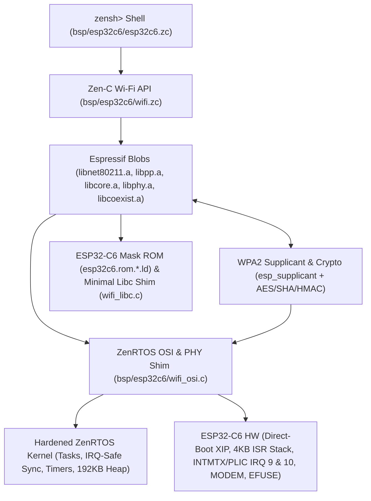

# Engineering Design Plan: ESP32-C6 Wi-Fi Support in ZenRTOS (Phase 1)

This document defines the architecture, memory layout, kernel prerequisites, toolchain/ROM integration, and phased implementation plan for adding **real hardware 2.4 GHz Wi-Fi (802.11b/g/n/ax STA)** support to **ZenRTOS** on the **ESP32-C6-Pico (RISC-V `RV32IMAC`)**.

> **Scope (Phase 1)**: Wi-Fi subsystem initialization, factory MAC readout, 2.4 GHz AP scanning, Open & WPA2-PSK STA association/disassociation exposed through the interactive `zensh>` shell (`wifi mac`, `wifi scan`, `wifi connect <ssid> [pass]`, `wifi status`, `wifi disconnect`). L3 TCP/IP (`lwIP` DHCP & ICMP `ping`) is deferred to Phase 2.

---

## 1. Architectural Reality & Layer Diagram

Espressif does **not** publish the ESP32-C6 Wi-Fi 6 MAC, baseband, or RF calibration register specifications. Real over-the-air Wi-Fi requires:
1. **Espressif's prebuilt RISC-V (`rv32imac`) static libraries** (`libnet80211.a`, `libpp.a`, `libcore.a`, `libphy.a`, `libcoexist.a`) for 802.11 MAC/PHY/RF calibration.
2. **WPA2 Supplicant & Crypto hooks (`wpa_crypto_funcs_t` + `esp_supplicant`)**: The closed-source `.a` blobs only handle 802.11 management frames, scanning, and Open authentication; PBKDF2-SHA1 PSK derivation and the 4-way WPA2 EAPOL handshake live in `esp_supplicant` + AES/SHA-1/SHA-256/HMAC crypto callbacks.
3. **ESP32-C6 Mask ROM Symbol Scripts (`esp32c6.rom.*.ld`)** + a minimal freestanding **`libc` / `compiler-rt` shim** so `clang --target=riscv32-unknown-elf -nostdlib -fuse-ld=lld` resolves all external references in GCC-compiled `.a` archives.
4. **ZenRTOS OS Integration (`wifi_osi_funcs_t`) adapter** bridging tasks, IRQ-safe critical sections, semaphores, recursive mutexes, byte queues, microsecond timers, heap allocation, and `INTMTX`/`PLIC_MX` interrupts.



---

## 2. Memory & Boot Upgrade: ESP32-C6 Hardware Direct-Boot XIP

### 2.1 Why Hardware Direct-Boot XIP (`0xAEDB041D`) Instead of `0xE9` Bootloader Segments
- **Bootloader constraint**: The ESP32-C6 **1st-stage mask ROM bootloader** only copies SRAM (`0x4080xxxx`) segments from an `0xE9` image at Flash `0x0000`—it does **not** configure Cache MMU mappings for `0x42000000` (`IROM`/`DROM`) segments without a 2nd-stage bootloader.
- **Direct-Boot solution**: ESP32-C6's ROM natively supports **Direct-Boot XIP** whenever the first 8 bytes at SPI Flash `0x00000000` are `0xAEDB041D, 0xAEDB041D` (which `bsp/esp32c6/startup.s` already uses!). When flashed **raw** to `0x00000000`:
  1. The ESP32-C6 ROM automatically configures the unified Cache MMU to map SPI Flash `0x00000000..0x003FFFFF` 1:1 to **`0x42000000..0x423FFFFF`** and jumps to `0x42000008` (`_start`).
  2. `_start` initializes `gp` (`__global_pointer$`) and `sp`, copies fast-path `.iram1` (`_mtvec_table`, ISR handlers, `.wifi0iram.*`, `.wifirxiram.*`) and `.data` from Flash (`LOADADDR` in `0x420xxxxx`) into HP SRAM (`0x40800000`), zeroes `.bss`, and enters `main()`.
- **Non-Wi-Fi build preserved**: Existing `make esp32c6` (~19 KB SRAM build) stays completely untouched; Wi-Fi builds under `make esp32c6-wifi` using `bsp/esp32c6/link_wifi.ld` and `scripts/esp32c6_load.py --raw-flash`.

### 2.2 Explicit 496 KB HP SRAM & 4 MB Flash XIP Budget (`bsp/esp32c6/link_wifi.ld`)

| Region | Address Range | Budget | Contents |
| :--- | :--- | :--- | :--- |
| **Flash XIP (`FLASH`)** | `0x42000000 .. 0x423FFFFF` | `~480 KB / 4 MB` | Direct-Boot magic (`+0x00`), `_start` (`+0x08`), `.text` & `.rodata` (`.rodata.wdev.*`) of Wi-Fi/PHY blobs, `esp_supplicant`, and ZenRTOS |
| **HP SRAM: `.iram1`** | `0x40800000 ..` | `~64 KB` | 256B-aligned `_mtvec_table`, `context.s`, `.iram1.*`, `.wifi0iram.*`, `.wifirxiram.*` |
| **HP SRAM: `.data` + `.bss`** | Follows `.iram1` | `~84 KB` | Blob static state (`libnet80211`, `libpp`, `libphy`, `libcoexist`), `.sdata`/`.sbss` (`__global_pointer$`), ZenRTOS TCBs & trace buffer |
| **HP SRAM: Stacks** | Static `.bss` | `~20 KB` | **4 KB dedicated `_isr_stack`** (`g_isr_stack`) + 6 KB Wi-Fi task stack + ZenRTOS app/timer task stacks |
| **HP SRAM: Wi-Fi Heap** | `g_wifi_heap_arena` | **`192 KB`** | 16-byte-aligned dynamic arena (`_malloc_internal` / `_calloc_internal` / RX & TX dynamic buffers / scan records / EAPOL state) |
| **HP SRAM Headroom** | Free up to `0x4087C000` | `~136 KB` | Safety margin below `_estack = 0x4087C000` (`496 KB` total usable HP SRAM; top `16 KB` `0x4087C000..0x4087FFFF` reserved for ROM) |

### 2.3 Tuned `wifi_init_config_t` Parameters
To keep runtime RAM deterministic inside the 192 KB heap:
- `static_rx_buf_num = 6`, `dynamic_rx_buf_num = 16`
- `tx_buf_type = 1` (dynamic), `dynamic_tx_buf_num = 16`
- `rx_ba_win = 6`, `ampdu_rx_enable = 1`, `ampdu_tx_enable = 1`
- `nvs_enable = 0`, `nano_enable = 0`

---

## 3. Kernel & RISC-V Architecture Hardening (Prerequisites)

Auditing `kernel/rtos.c` and `arch/riscv/rv32/context.s` against `wifi_osi_funcs_t` identified **six** mandatory kernel/arch upgrades before linking Wi-Fi blobs:

### 3.1 Fix `kernel/rtos.c` Scheduler & Blocking Edge Cases
1. **Non-blocking `timeout_ticks == 0` vs. `RTOS_WAIT_FOREVER` (`0xFFFFFFFFUL`)**:
   - Currently `rtos_sem_wait(sem, 0)` blocks forever because `sleep_ticks = 0` is skipped by `SysTick_Handler`.
   - Update `rtos_sem_wait()` and `rtos_mutex_lock()`:
     - If `timeout_ticks == 0` and resource is unavailable -> return `false` immediately without blocking (`_semphr_take(sem, 0)` poll path).
     - Define `#define RTOS_WAIT_FOREVER 0xFFFFFFFFUL`: in `SysTick_Handler`, only decrement `sleep_ticks` when `sleep_ticks > 0 && sleep_ticks != RTOS_WAIT_FOREVER`.
2. **Multiple Tasks at the Same Priority & Round-Robin**:
   - In `rtos_sem_wait()` and `rtos_mutex_lock()`, only clear `g_ready_bitmap &= ~(1UL << prio)` if **no other `TASK_STATE_READY` task** shares `prio` (matching `rtos_delay()`).
   - Update `rtos_schedule()` to start scanning `g_tasks[]` at `(current_idx + 1) % RTOS_MAX_TASKS` so equal-priority ready tasks time-slice fairly instead of starving behind lower-index tasks.
3. **Mutex Wait Barrier & Timeout Check**:
   - Add the missing `while (curr->state == TASK_STATE_BLOCKED) {}` wait barrier + post-wakeup ownership verification in `rtos_mutex_lock()` so timeouts return `false` cleanly.
4. **Dynamic Task Deletion (`rtos_task_delete`)**:
   - Introduce `TASK_STATE_UNUSED` in `task_state_t` so `rtos_task_create()` reuses freed TCB slots and `rtos_task_delete(tcb_t *task)` cleanly removes helper tasks spawned by `libnet80211` / `esp_supplicant`.

### 3.2 State-Saving Critical Sections & ISR-Safe Primitives
- **Problem**: `rtos_exit_critical()` currently runs `csrsi mstatus, 0x8`, unconditionally re-enabling global interrupts (`MIE = 1`) even if called inside an ISR or nested inside `_wifi_int_disable()`!
- **Design**:
  - Add `uint32_t rtos_irq_save(void)` (`csrrci %0, mstatus, 0x8` on RISC-V; `MRS PRIMASK` + `cpsid i` on ARM) and `void rtos_irq_restore(uint32_t flags)` (`csrw mstatus, %0` / `MSR PRIMASK`).
  - Refactor all critical sections in `kernel/rtos.c` to use `rtos_irq_save()` / `rtos_irq_restore(flags)`.
  - Add `rtos_sem_signal_from_isr(rtos_sem_t *sem, bool *higher_prio_woken)` so Wi-Fi MAC ISRs wake the Wi-Fi task without spinning or clobbering `mstatus`.

### 3.3 Dedicated 4 KB RISC-V Interrupt Stack & `INTMTX`/`PLIC_MX` Dispatch (`arch/riscv/rv32/context.s`)
- **Problem**: `libpp.a`'s `WIFI_MAC` ISR (`wDev_ProcessFiq`) consumes **~1.5–2.5 KB of stack**. Running ISRs on the interrupted task's `sp` (`Idle` = 512 B, `Sensor` = 1 KB) guarantees stack corruption.
- **Design**:
  1. Allocate `uint8_t g_isr_stack[4096] __attribute__((aligned(16)))` (`_isr_stack_top`) and `volatile uint32_t g_isr_nest_depth = 0`.
  2. On entry to `riscv_mtimer_handler` and `riscv_ext_irq_handler`:
     - `SAVE_CONTEXT` onto current stack; if `g_isr_nest_depth++ == 0`, store `sp` into `current_tcb->sp` and load `sp = _isr_stack_top`.
     - Call C handler (`bsp_riscv_ext_irq_dispatch(mcause & 0x1F)`).
     - Decrement `g_isr_nest_depth`; when returning to `0`, check `next_tcb` (switching `current_tcb = next_tcb` and clearing pending `MSIP` if set), load `sp = current_tcb->sp`, `RESTORE_CONTEXT`, and `mret`.
  3. **Slot Assignment (Avoiding CLINT Collisions)**:
     - Slots `0, 3, 4, 7` in `_mtvec_table` remain reserved for synchronous exceptions and CLINT (`MSIP = 3`, `MTIMER = 7`).
     - Route `WIFI_MAC_INTR_SOURCE (0)` -> **CPU IRQ 9** and `WIFI_PWR_INTR_SOURCE (2)` -> **CPU IRQ 10** via `INTMTX` (`0x60010000`), configure priority `>= 1` and enable bits `9..10` in `PLIC_MX` (`0x20001000`), and set `(1 << 9) | (1 << 10)` in CSR `mie`.

### 3.4 Software Timers & 1-Microsecond Monotonic Clock
- Implement `bsp_timer_get_us() -> uint64_t`: read 64-bit `CLINT MTIME` (ticking at 160 MHz HP clock on ESP32-C6 -> divide by `160`, or read `SYSTIMER UNIT0` @ 16 MHz -> divide by `16`) to supply exact **1 MHz (`1 us`)** timestamps for `_esp_timer_get_time()`.
- Implement `rtos_timer_t` software timers serviced by a high-priority `Timer` task (`4 KB` stack, priority `2`) for `wifi_osi_funcs_t._timer_arm` / `_timer_arm_us` / `_timer_disarm`.

### 3.5 RISC-V Global Pointer (`gp`) & Toolchain ABI Compatibility
- Update `Makefile` (`CFLAGS_ESP32C6_WIFI`) to pass `-march=rv32imac_zicsr_zifencei -mabi=ilp32`.
- Define `__global_pointer$ = MIN(_sdata + 0x800, MAX(_sdata + 0x800, _ebss - 0x800))` in `link_wifi.ld` and initialize `gp` in `startup.s` (`.option push; .option norelax; la gp, __global_pointer$; .option pop`) before calling any C or blob functions.

---

## 4. Espressif Blobs, ROM Linker Scripts & Minimal Libc

To keep the repository clean and self-contained:
- Add `third_party/esp32c6_wifi/` to `.gitignore`.
- Create `scripts/fetch_esp32c6_wifi_blobs.sh` pinning a single matching ESP-IDF v5.3.x release set:
  1. **Wi-Fi static archives** (`espressif/esp32-wifi-lib` `esp32c6`): `libnet80211.a`, `libpp.a`, `libcore.a`, `libcoexist.a`.
  2. **PHY calibration archives** (`espressif/esp-phy-lib` `esp32c6`): `libphy.a`, `libbtbb.a`.
  3. **ESP32-C6 Mask ROM symbol linker scripts** (from ESP-IDF `components/esp_rom/esp32c6/ld/`):
     - `esp32c6.rom.ld`, `esp32c6.rom.api.ld`, `esp32c6.rom.phy.ld`, `esp32c6.rom.coexist.ld`, `esp32c6.rom.net80211.ld`, `esp32c6.rom.pp.ld`.
  4. **Open-source WPA2 supplicant & crypto sources** (`esp_supplicant` minimal STA subset + AES/SHA-1/SHA-256/HMAC/PBKDF2) compiled directly with `clang --target=riscv32-unknown-elf`.
- Implement **`bsp/esp32c6/wifi_libc.c`**: minimal freestanding `memcpy`, `memset`, `memmove`, `memcmp`, `strlen`, `strcpy`, `strncpy`, `strcmp`, `strncmp`, `strchr`, `strstr`, `snprintf`, `vsnprintf`, `abs`, and 64-bit compiler-rt helpers (`__udivdi3`, `__umoddi3`, `__divdi3`, `__ashldi3`, `__lshrdi3`) required when linking with `-nostdlib`.

---

## 5. ZenRTOS OSI & Crypto Adapter (`bsp/esp32c6/wifi_osi.c`)

| OSI / Crypto Group | Espressif Hook(s) | ZenRTOS Implementation |
| :--- | :--- | :--- |
| **Interrupts** | `_set_intr`, `_clear_intr`, `_set_isr`, `_ints_on`, `_ints_off` | Map `WIFI_MAC (0)` -> CPU IRQ 9 & `WIFI_PWR (2)` -> CPU IRQ 10 in `INTMTX` (`0x60010000`) + `PLIC_MX` (`0x20001000`); register ISR in `g_ext_isr_table[32]`; toggle `mie` bits. |
| **Spinlocks / IRQ Mask** | `_spin_lock_create`, `_wifi_int_disable`, `_wifi_int_restore` | Backed directly by `rtos_irq_save()` / `rtos_irq_restore(flags)` (preserves nested IRQ state). |
| **Tasks** | `_task_create_pinned_to_core`, `_task_create`, `_task_delete`, `_task_delay`, `_task_get_current_task`, `_task_ms_to_tick` | Heap-allocate stack + call `rtos_task_create()` (mapping ESP prio `1..24` -> ZenRTOS prio `28..5`); `rtos_task_delete()`; `rtos_delay()`. |
| **Semaphores & Mutexes** | `_semphr_create`, `_semphr_delete`, `_semphr_take`, `_semphr_give`, `_mutex_create`, `_recursive_mutex_create`, `_lock_mutex`, `_unlock_mutex` | Map `OSI_SEM_TIME_BLOCKING` -> `RTOS_WAIT_FOREVER` and `0` -> non-blocking try-take; use `rtos_sem_signal_from_isr` when `g_isr_nest_depth > 0`; `rtos_mutex_t` already supports recursive lock + priority inheritance. |
| **Generic Queues** | `_queue_create`, `_queue_delete`, `_queue_send`, `_queue_send_from_isr`, `_queue_recv`, `_queue_msg_waiting` | Byte-ring buffer (`item_size * queue_len`) synchronized via `rtos_sem_t` (`items_avail`, `slots_free`) + `rtos_irq_save()`. |
| **Timers & Clock** | `_timer_arm`, `_timer_arm_us`, `_timer_disarm`, `_timer_done`, `_timer_setfn`, `_esp_timer_get_time` | `rtos_timer_t` + `bsp_timer_get_us()` (`1 us` monotonic counter). |
| **Heap Memory** | `_malloc`, `_calloc`, `_realloc`, `_free`, `_malloc_internal`, `_calloc_internal`, `_zalloc_internal` | 192 KB 16-byte-aligned free-list allocator in HP SRAM (`wifi_heap.c`), protected by `rtos_irq_save()`. |
| **Modem, PHY & eFuse** | `_read_mac`, `_rand`, `_phy_enable`, `_phy_disable`, `_modem_clock_enable`, `_coex_init` | Read 6-byte factory MAC + CRC from `EFUSE` (`0x600B0800`); hardware TRNG (`LP_PERI RNG_DATA`); ungate `MODEM_SYSCON` (`0x600A9800`) & `MODEM_LPCON` (`0x600AF000`) clocks before `esp_phy_enable(PHY_MODEM_WIFI)`. |
| **WPA2 Crypto** | `g_wifi_default_wpa_crypto_funcs` (`aes_wrap`, `hmac_sha1`, `hmac_sha256`, `pbkdf2_sha1`, etc.) | Provided by `esp_supplicant` + software/HW SHA & AES routines for WPA2-PSK 4-way handshake. |
| **NVS & Logging** | `_nvs_open`, `_nvs_get_*`, `_nvs_set_*`, `_log_write`, `_log_timestamp` | `nvs_enable = 0` in `wifi_init_config_t` (stubs return `ESP_ERR_NVS_NOT_FOUND`); `_log_write` routes errors/info to `bsp_uart_puts()`. |

---

## 6. Target File Structure

```text
zen-rtos/
├── arch/riscv/rv32/
│   └── context.s                    # [UPDATE] Add 4KB _isr_stack switch + external IRQ slots 8..31
├── kernel/
│   ├── include/rtos.h               # [UPDATE] Add RTOS_WAIT_FOREVER, rtos_irq_save/restore,
│   │                                #          rtos_task_delete, rtos_sem_signal_from_isr, rtos_timer_t
│   └── rtos.c                       # [UPDATE] Fix timeout=0, round-robin prio, IRQ-safe critical sections
├── bsp/esp32c6/
│   ├── startup.s                    # [UPDATE] Init gp (__global_pointer$); copy .iram1/.data in XIP mode
│   ├── link.ld                      # Unchanged (19 KB SRAM-only build)
│   ├── link_wifi.ld                 # [NEW] Direct-Boot XIP (0x42000000) + HP SRAM (0x40800000) + ROM .ld
│   ├── esp32c6.zc                   # [UPDATE] Wire 'wifi ...' commands into zensh> when WIFI enabled
│   ├── wifi.zc                      # [NEW] Zen-C Wi-Fi API & zensh> command handlers
│   ├── wifi_osi.c                   # [NEW] wifi_osi_funcs_t, INTMTX/PLIC, MODEM/PHY init, byte queues
│   ├── wifi_heap.c                  # [NEW] 192 KB 16-byte-aligned HP SRAM allocator (malloc/realloc/free)
│   └── wifi_libc.c                  # [NEW] Minimal freestanding libc + 64-bit compiler-rt helpers
├── scripts/
│   ├── fetch_esp32c6_wifi_blobs.sh  # [NEW] Fetch pinned esp32c6 blobs, ROM .ld scripts & esp_supplicant
│   └── esp32c6_load.py              # [UPDATE] Add --raw-flash Direct-Boot XIP programming @ 0x00000000
├── third_party/esp32c6_wifi/        # [GITIGNORED] Pinned .a archives, ROM .ld scripts & headers
├── tests/host/
│   └── test_scheduler.c             # [UPDATE] Unit tests for timeout=0, round-robin, task_delete & timers
├── docs/
│   └── WIFI_PLAN_ESP32C6.md         # [THIS DOCUMENT]
└── Makefile                         # [UPDATE] Add esp32c6-wifi & flash-esp32c6-wifi targets
```

---

## 7. Interactive `zensh>` Shell Interface (Phase 1)

| Command | Behavior |
| :--- | :--- |
| `wifi mac` | Reads and prints the 6-byte factory STA MAC address (`XX:XX:XX:XX:XX:XX`) from ESP32-C6 `EFUSE`. |
| `wifi scan` | Runs an active 2.4 GHz scan (`esp_wifi_scan_start`) and prints `SSID`, `BSSID`, `Ch`, `RSSI (dBm)`, and `Auth` (`OPEN`, `WPA2-PSK`, `WPA3-SAE`). |
| `wifi connect <ssid> [pass]` | Configures `WIFI_MODE_STA` (Open if `pass` omitted, WPA2-PSK if provided) and associates with the AP. |
| `wifi status` | Prints STA state (`UNINIT`, `IDLE`, `SCANNING`, `CONNECTING`, `CONNECTED`), SSID, channel, RSSI, and free Wi-Fi heap watermark. |
| `wifi disconnect` | Calls `esp_wifi_disconnect()` and returns STA state to `IDLE`. |

---

## 8. Phased Implementation & Verification Roadmap

### Phase 1A: Kernel Hardening, 4 KB ISR Stack & `EFUSE` MAC (Zero Blobs)
1. Implement `rtos_irq_save`/`restore`, `timeout_ticks == 0` / `RTOS_WAIT_FOREVER`, shared-priority round-robin, `rtos_mutex_lock` wait barrier, `rtos_task_delete`, `rtos_sem_signal_from_isr`, `rtos_timer_t`, and `wifi_heap.c`.
2. Add host unit tests in `tests/host/test_scheduler.c` and verify `make test`, `make build` (STM32L476), `make rt1021`, and `make esp32c6` all pass.
3. Add the 4 KB `_isr_stack` + `INTMTX`/`PLIC_MX` dispatcher in `arch/riscv/rv32/context.s` and `wifi mac` (`EFUSE` readout) on `/dev/ttyACM1`.

### Phase 1B: Direct-Boot Flash XIP (`0x42000000`) Bring-Up
1. Create `bsp/esp32c6/link_wifi.ld` (`gp` symbol + `.iram1`/`.data` LMA in Flash XIP `0x42000000`, VMA in `0x40800000`), update `bsp/esp32c6/startup.s`, and add `--raw-flash` support to `scripts/esp32c6_load.py`.
2. Flash to `/dev/ttyACM1` and verify ZenRTOS boots cleanly from XIP at `0x42000008` with `zensh>` interactive shell working across power cycles.

### Phase 1C: Fetch Blobs, ROM `.ld` Scripts & Link `wifi_osi.c`
1. Create `scripts/fetch_esp32c6_wifi_blobs.sh` to download pinned `esp32c6` `.a` archives + `esp32c6.rom.*.ld` scripts.
2. Implement `bsp/esp32c6/wifi_libc.c` and `bsp/esp32c6/wifi_osi.c` (`wifi_osi_funcs_t`, `MODEM_SYSCON`/`MODEM_LPCON` clocks, `esp_phy_enable`).
3. Verify `make esp32c6-wifi` links with **zero unresolved symbols** under `clang` + `ld.lld` and fits cleanly within the 496 KB HP SRAM budget.

### Phase 1D: RF/PHY Init, `wifi scan` & Open AP Connect on `/dev/ttyACM1`
1. Implement `bsp/esp32c6/wifi.zc` and wire `wifi mac|scan|connect|status|disconnect` into `zensh>`.
2. Flash to `/dev/ttyACM1` and verify:
   - [ ] `esp_wifi_init()` + `esp_wifi_start()` complete without WDT reset or stack canary trip (`mem` -> `PASS`).
   - [ ] `wifi scan` discovers real nearby 2.4 GHz access points with valid SSID, channel, and RSSI.
   - [ ] `wifi connect <open_ssid>` associates cleanly at 802.11 L2.

### Phase 1E: `esp_supplicant` & WPA2-PSK 4-Way Handshake
1. Compile and register `esp_supplicant` + `g_wifi_default_wpa_crypto_funcs` (`PBKDF2-SHA1`, `AES-128`, `HMAC-SHA1/SHA256`).
2. Verify `wifi connect <ssid> <password>` completes the WPA2-PSK 4-way EAPOL handshake on `/dev/ttyACM1` and sustains beacon keepalive under `wifi status`.

---

## 9. Phase 2 Preview (Future Follow-Up)
Once Phase 1E WPA2 STA association is verified on hardware, Phase 2 can attach **lwIP** (`esp_wifi_internal_tx` / `esp_wifi_internal_reg_rxcb`) to add:
- **DHCPv4** client IP acquisition (`wifi ip`)
- **`ping <ip>`** ICMP echo diagnostic command in `zensh>`
- **UDP/TCP** telemetry sockets
